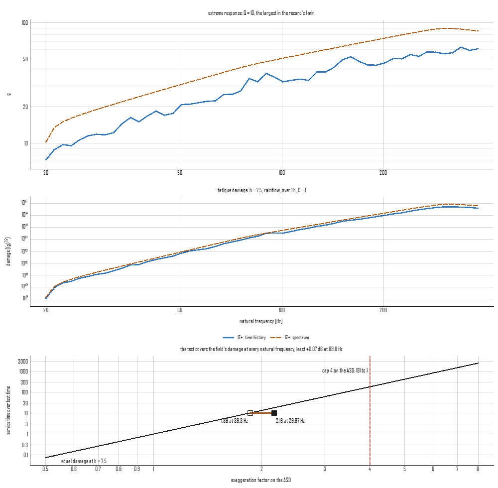

# Fatigue damage, extreme response and time compression

Two vibration environments are not compared by laying their spectra on
one plot. A field record and the test written to stand for it differ in
shape, in level and in duration, and what matters is what each does to
the article. So both are run through the same set of single-degree-of-
freedom resonators, one at each natural frequency across the band, and
two numbers are read off each resonator's response:

- the **extreme response spectrum** (ERS), the largest response the
  resonator reaches over the duration: the strength question;
- the **fatigue damage spectrum** (FDS), the fatigue damage that
  response does over the duration: the life question.

A test whose ERS and FDS stand at or above the field's at every natural
frequency is at least as severe, mode for mode, whatever its shape.
That is how a specification is derived from field data, and how the
question "is this test harder than that one" gets an answer.

## The resonators and the damage

Each resonator is base-excited at natural frequency f<sub>n</sub> and
amplification Q. Its response is the relative displacement z between
mass and base, the motion that strains a part, written as a
pseudo-acceleration (2πf<sub>n</sub>)²z so it reads in the input's
unit. Its gain from base acceleration is

\[
H(f) = \frac{1}{1 - r^2 + j\,r/Q}, \qquad r = f/f_n ,
\]

one at low frequency, Q at f<sub>n</sub>. Under a flat density G the
response's mean square is exactly (π/2) f<sub>n</sub> Q G, Miles'
equation, and it crosses zero upward exactly f<sub>n</sub> times a
second.

Fatigue is read through an S-N curve, N S<sup>b</sup> = C: a cycle of
amplitude S uses S<sup>b</sup>/C of the life, and the cycles add (the
Palmgren-Miner rule). C and the stress per unit response belong to a
material and a design, so they are left at one: the FDS is in the
response unit to the power b, a number to compare between environments
read at the same b and Q, not a life. For a response with rms σ that
crosses zero ν₀ times a second, counting every crossing as a cycle of
Rayleigh-distributed amplitude gives the narrow-band damage over a
duration T,

\[
D = \nu_0\,T\,\bigl(\sqrt{2}\,\sigma\bigr)^b\,\Gamma\!\left(1 + \tfrac{b}{2}\right),
\]

and the ERS is σ times the expected largest peak,
σ√(2 ln ν₀T), the leading term of the standard result (a run usually
reaches a little more).

A spectrum's cycles can be read three ways:

- **narrowband**, the closed form above, the default. A resonator's
  response is narrow-band, and for a broader one this expects more
  damage than rainflow counting finds, erring on the safe side.
- **rice**, every positive peak a cycle of its own height, the heights
  distributed as Rice's peaks for the response's irregularity (one for
  a pure tone, smaller when small peaks ride on large ones).
- **dirlik**, the rainflow ranges as Dirlik's empirical fit gives them
  from the response's spectral moments. It is a fit to simulated
  rainflow counts, and the package checks it against rainflow counts of
  simulated records.

A time history is counted directly: each resonator's response is
reduced to its turning points and counted by rainflow, every closed
cycle at its range, the residue as half cycles, and the ERS is the
largest response in the record. Natural frequencies above a twentieth
of the sample rate are refused, since a sampled response's peaks fall
between samples and the damage goes as the amplitude to the power b;
the result says how low its top resonator reads.

## Time compression

At one exponent, a test at ASD W₁ for a time t₁ does the damage of the
service level W₂ for t₂ when

\[
\frac{t_2}{t_1} = \left(\frac{W_1}{W_2}\right)^{b/2},
\]

the rule test documents give for trading time for level. The ratio
W₁/W₂ is the exaggeration factor on the ASD; documents commonly cap it
at 4 (2 on the rms), because a higher level can fail an article through
a mechanism the exponent does not describe. The exponent is the
document's convention, commonly 7.5 for random and 6 for sine, and it
is never assumed here: every reading names its b. A tenfold compression
at 7.5 is 1.848 on the ASD, +2.67 dB; at 4 it is +5 dB. At the cap,
7.5 allows 181 to 1 and 4 allows 16.

## From a script

```python
from visualdynamics.core.fatigue import (psd_spectra, history_spectra,
                                         compared, time_compression)

field = psd_spectra(spec, b=7.5, duration=3600.0, frequencies=[100.0])
field.rms / 9.80665          # 7.875 g: Miles' 7.93, less the band's ends
field.crossings              # 100.5 upward crossings a second
field.ers / 9.80665          # 39.84 g, expected over the hour
print(field.rests_on)        # the reading, b, Q and the peak's formula

record = history_spectra(run, b=7.5)            # counted by rainflow
pair = compared(run, test_spec, field_duration=3600.0,
                test_duration=360.0, b=7.5)     # one set of frequencies
pair.damage_db               # test over field, per natural frequency
pair.factor_needed           # on the test's ASD to cover the field
pair.duration_needed         # or the test's time at its own level
pair.exaggeration            # the factor the test carries, per frequency
print(pair.describe())

print(time_compression(b=7.5, time_ratio=10.0).describe())
# compresses time 10 to 1 at 1.848 on the ASD (+2.67 dB, 1.359 on the
# rms), b = 7.5; within the cap of 4 on the ASD

visualdynamics.plot.plot_fatigue(run, b=7.5, duration=3600.0,
                                 against=test_spec, against_duration=360.0,
                                 path='fatigue.png')
```

Here `spec` is a flat 0.04 g²/Hz from 20 to 2000 Hz. Values are in
SI, as every record is; the FDS is in (m/s²)<sup>b</sup> and the plot
draws it in the display unit to the power b. `fatigue_spectra(data,
record, ...)` takes either a PSD or a time history, and a duration
given for a time history scales its FDS from the record's length, which
takes the record as a stationary sample of the whole; its ERS stays the
record's own. `ResponseSpectra.at_duration` does the same afterwards.

What cannot be read one way is refused with its cause: a record whose
units are not declared, a record of another quantity than acceleration,
a cross spectrum, a line or sample that is not finite (its frequency or
time named), a line below zero, a spectrum with no area or a record
that does not vary, a Q outside 1 to 500 or a b outside 2 to 25, and a
spectrum with no duration. Two results set against each other must be
read at one Q, one b and one set of natural frequencies.



The figure (`tools/make_concept_figures.py`) is one minute of a
vehicle floor's record, taken as a sample of an hour in service, flat
at 0.02 g²/Hz from 20 to 80 Hz and 0.04 to 300 Hz then falling, set
against a specification on the same breakpoints at twice the density
for six minutes, at b = 7.5. A time ratio of ten wants 1.85 on the ASD
and the test carries 2, so its FDS covers the field's at every natural
frequency; the bar on the rule runs from the least exaggeration the
test carries (the hollow square, the governing frequency, where the
minute ran hardest) to the most, right of the equal-damage line and
well left of the cap. The test's ERS, expected over six minutes, stands
above the largest response the minute reached.

## In the app

Select one acceleration record (a PSD, a specification, or one channel
of a time history) and press **Fatigue** on the bar. The plot is the
ERS, the FDS and the time-compression rule at b with its cap; the pane
beside it sets the candidate test (any other acceleration record in the
project), b, Q, the reading of a spectrum's cycles and the durations,
and reads out what each result rests on and, with a test, the least
damage margin and where, the factor and the duration that cover the
field, the exaggeration against the cap and the least ERS margin. A
spectrum carries no duration, so the reading waits for one and says
so. A long record is counted on the window's worker, and a redraw with
nothing changed draws the kept result. The reading is journaled as its
`plot_fatigue` call.
