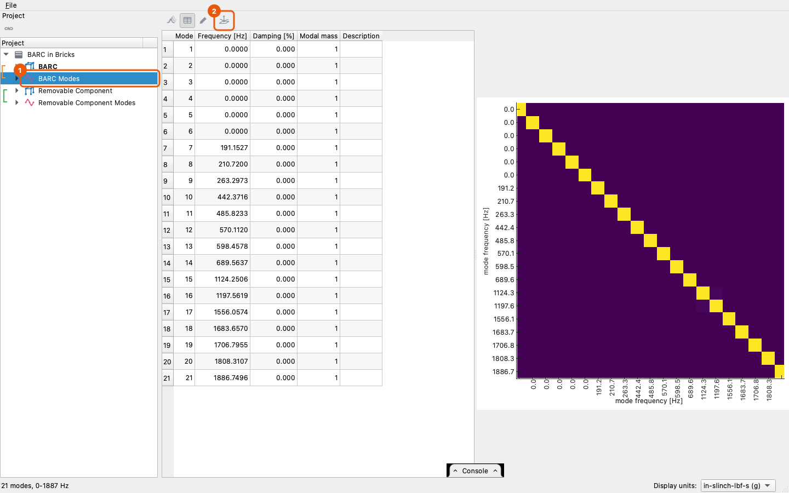

# Planning a test's instrumentation

Plan Instrumentation chooses where to put the accelerometers for a modal
or vibration test, from the finite element model's mode shapes. It uses
Effective Independence (Kammer, "Sensor placement for on-orbit modal
identification and correlation of large space structures", Journal of
Guidance, Control, and Dynamics 14(2), 1991): of all the places a sensor
could go, it keeps the ones that best tell the chosen modes apart.

It takes a number of tri-axial and uni-axial accelerometers and places
the tri-axial ones first. Each uni-axial one is then placed at a place
of its own, measuring along the surface normal unless told otherwise.
The plan is kept as three objects: an experimental geometry of the
chosen places, a channel table, and the finite element modes at exactly
those channels, ready to correlate with the test.

## Where a sensor can go

A sensor goes on the outside of the model. The places are built from
the model's surfaces:

- A solid contributes only its outer surface. Its inside is never a
  place, and neither is a face where two parts touch, whether they share
  nodes or only lie against each other.
- The outside is split into surfaces at its sharp edges. Two neighboring
  faces are on one surface while their normals are within the surface
  edge angle, 20 degrees unless set. The angle is between neighbors, so
  a curved surface is one surface however far round it turns: a
  cylinder's side, a fillet, the inside of a bore. Nodes in the same
  place are taken as one node, so a mesh whose coincident nodes were
  never merged gives the same surfaces as one that was.
- A plate contributes all of itself; a beam, every node.
- A surface of less than 1 % of the outside's whole area starts out
  left out: sensors go on the significant surfaces, and a small one is
  most often a sliver along an edge, a fillet or a bore. A click brings
  one back. On a model where no surface is that large, every surface
  starts out in.
- A place keeps a distance from its surface's edge, a quarter of an inch
  unless set (none on a model whose units are not declared), so a
  sensor is not planned where it would hang over a corner. A sharp edge, a free edge, a hole and a seam with another
  part all count as edges.

Each place is measured in a coordinate system of its own. +Z is the
outward normal of the surface, and +X lies in the surface along the
system axis least aligned with the normal, so on a face that is square
to the model's axes the place's X and Y are model axes too. A node on an
edge between two surfaces is a place on each of them, so that a sensor
sits flat on one face or the other.

## Choosing the sensors

Effective Independence starts from every place and removes, one at a
time, the place whose loss costs the least information about the modes.
Tri-axial accelerometers are chosen first, each place as a block of
three directions; then uni-axial ones at the remaining places, with the
tri-axial ones fixed. While far more places remain than are wanted, it
removes the weakest tenth at a time, so a model with tens of thousands
of surface nodes is planned in seconds.

Sensors measuring D directions (three per tri-axial, one per uni-axial)
can tell at most D modes apart. With fewer directions than modes, the
plan is made for the lowest D modes by frequency, and the reading says
which modes the sensors cannot tell apart. The tri-axial accelerometers
on their own are held to the same rule: they are chosen for the lowest
three times as many modes as there are tri-axials, and the uni-axial
ones then for all the modes planned for.

The choices agree with sdynpy's `by_effective_independence` on the
problems where both remove one place at a time.

## In the app

Select a shape set of finite element modes, or pick some of its modes
in its grid, and press Plan Instrumentation on the bar.



The pane opens beside the 3-D view, with the model's surfaces drawn and
the planned sensors on them: each tri-axial accelerometer as a triad of
its place's axes, each uni-axial one as an arrow, X red, Y green and Z
blue.


- The modes measured are the ones selected: the modes picked in the
  shape set's grid, or every mode above 0 Hz when the shape set itself
  is selected. Pick other modes while the pane is open and it plans for
  them.
- Place on lists the element groups; uncheck one to keep sensors off it.
- The surfaces sensors may go on are drawn in the solid color and the
  ones left out in gray; the small ones start out gray. Click a surface to leave it out or put it back;
  the surface under the cursor lights up. Dragging turns the view as
  usual and changes nothing. All puts every surface back, None leaves
  every one out, to click back the few wanted.
- Surface edge is the angle that splits the outside into surfaces.
  Raise it for a coarse curved mesh that comes out as a strip of
  surfaces.
- Away from edges is the distance a place keeps from its surface's
  edge, in the display unit system.
- Tri-axial and Uni-axial are the counts. Uni-axial along is the
  surface normal, or any direction of the place's system.
- The reading under the settings gives the counts, the channels, how
  many places were chosen out of how many, the worst off-diagonal term
  of the auto-MAC at the chosen channels, and the condition number of
  the information matrix. A lower worst MAC and a lower condition number
  both mean the sensors tell the modes apart better.

Keep adds the plan to the project as three linked objects named from the
Name box: '... Geometry', '... Channels' and '... Shapes'. The shapes
hold every mode that was selected, even those the plan could not
resolve, so their auto-MAC shows what the instrumentation will and will
not separate.

## From a script

```python
added = project.plan_instrumentation('Geometry Modes', 12, 6)
added['geometry'], added['channels'], added['shapes']
# ('Geometry Modes Plan Geometry', 'Geometry Modes Plan Channels',
#  'Geometry Modes Plan Shapes')
project[added['shapes']].auto_mac()
```

The options are the pane's: `modes=` (indices; every mode above 0 Hz by
default), `groups=` (ids or names), `surfaces=` (the surface numbers
kept; by default those of at least 1 % of the area), `edge_angle=` (degrees), `edge_distance=` with `unit=`, `axes=`
(0, 1, 2 for a place's X, Y, Z; `(2,)`, the normal, by default) and
`name=`. With fewer directions than modes the call plans for the lowest
and warns with `core.instrumentation.FewerDirectionsWarning`.

The steps are also open one at a time in `visualdynamics.core.instrumentation`:
`skin` splits the outside into numbered surfaces, `candidates` builds
the experimental geometry of the places, `local_shapes` reads the modes
in each place's directions, `effective_independence` chooses, and
`assemble` makes the three objects.

## What it does not do yet

Sensors cannot be required at or kept from particular places other than
by surface, and the order in which sensors would be added is not given.
A large hole's bore counts as a surface like any other; leave it out
with a click.
