# The project tree

Most work in Visual Dynamics starts from the project tree. It lists
what the project holds, and what you *select* in it decides what the
right-hand side shows: one object on its own, records or modes picked
inside one, or several objects together. Much of the application is
in the readings these combinations give, and this page describes each
of them.

The status line along the bottom of the window says what the last
action did, or why it was refused. Its text can be selected with the
mouse and copied with Cmd+C (Ctrl+C on Windows and Linux) or its
right-click menu, so a message can go into a note or a report as
written.

## What the tree shows

The top row is the project. Under it there is one row per object, in
a fixed order by kind, so the same project always reads the same way:
geometries, photographs, the channel table, time data, spectra, PSDs,
shock spectra, sine sweep specifications and sine levels, FRFs,
coherence, shape sets, matched modes, and the report last. A
specification sorts beside the kind of measurement it is for (a PSD
specification with the PSDs, a shock specification with the shock
spectra, a transient specification with the time data).

A bracket down the left side joins the objects of one object group
([Projects, links, and the Basis](projects.md)). The Basis group's
bracket is blue and heavier than the others, and each other group has
a color of its own. An object group can be named, either by
right-clicking its bracket and choosing *Name Object Group…* or with
`project.link(..., name=...)`. The name is written along the bracket in
its color, and it is the name the group is given when the project is
written as an Engineering Sciences Common Data Format file, where an
object group is an activity.

A project with a type shows a gray row for every object its report
still expects. Right-click one to see what can fill it, or press
**Automatic** on the bar above the tree to compute every slot the
loaded data can fill and generate the report ([Reports](reports.md)).

Every object that holds more than one thing expands into a grid.
The rows are coordinates (or modes, or photographs), and the columns
are whatever tells one record from another: the reference of a matrix
of measurements, the capture of a repeated one, or a single column
when the row alone identifies the record. Each cell's icon shows what
that record measures. Selecting cells picks records; selecting the
object's own row picks the whole object. Double-click a coordinate to
type over it ([The objects](objects.md#the-data-arrays-coredata)).

A time history's grid has one more column, shown first: **Role**,
which says what each channel is to an FRF. It is `ref` (a reference,
which drives), `resp` (a response) or `mon` (a monitor, recorded but
in no FRF). FRFs and multiple coherence are computed from the
references to the responses. Click a role to change it. Without a
channel table, a force or a moment starts as a reference; an
acceleration, velocity or displacement (or the rotational equivalent)
as a response; and anything else (volts, pressure, strain,
temperature, or a channel whose quantity is not declared) as a
monitor. A history imported with its channel table takes the roles the
table states, and a Rattlesnake file marks the channels it drove.

The time data's roles are the ones that count, and a channel table
linked with the data it describes shows them: change a role on the
data's grid or in the table's Role column and both change. Linking a
channel table to time data after the fact works the same as importing
them together. Every role the table declares is given to the data, a
channel the table leaves blank keeps the data's role, and the status
bar says which roles the link changed. A table that describes none of
the data's channels is left alone. A channel's Control check and its
role are independent, so a controlled channel can be a reference, a
response or a monitor. A role belongs to a channel, not to a point: a
drive point's load cell and the accelerometer beside it are two rows,
and making the accelerometer the reference gives acceleration over
acceleration, a transmissibility. The roles are stored on the history
(`history.roles`, `{(DOF, quantity): role}`), saved with it and
recorded in the console, and anything computed under the old roles
gets the refresh badge.

Clicking the project row clears the panes on the right, and the
bar holds the project's three acts: *Generate Report*; **+** *New
Geometry*, which adds an empty geometry in the display length unit to
build a model in; and *New Channel Table*, which adds an empty channel
table to type channels into ([the channel table](channel-table.md)). In a geometry, the **Quads** row offers *Add Plane*
and the **Hexes** row *Add Block*, since each adds elements of that
family ([the finite element workflow](workflows/fem-workflow.md)). The
**Solids** row offers *Add Solid Block*, *Add Cylinder*, *Add Cone*,
*Add Sphere* and *Add Section*: shapes to combine, pattern and then mesh
([the solid workflow](workflows/fem-solids.md)).

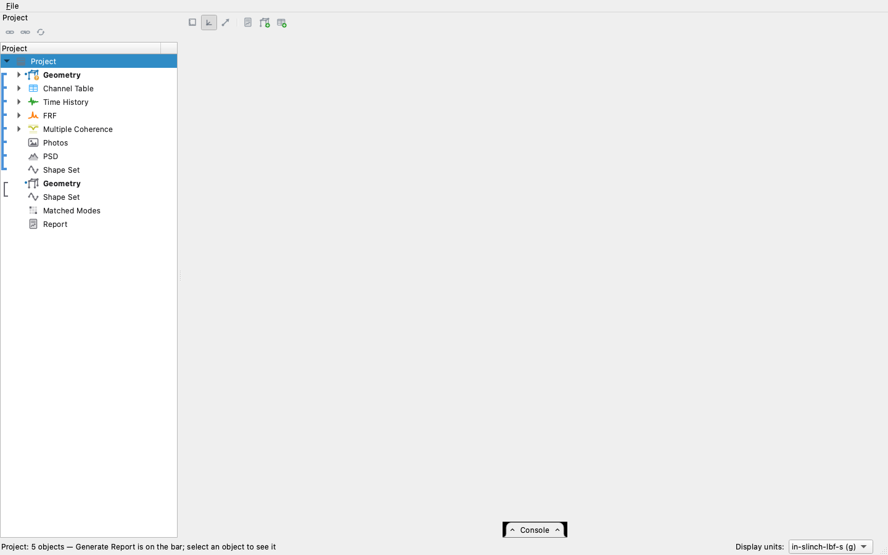

## One object at a time

Most data opens on the 3-D stage, with the channels receding and
colored by level; *3D* on the bar switches to the flat plot and back.

| selected | what the right side shows |
| --- | --- |
| Geometry | The 3-D scene. The tree lists the nodes, the coordinate systems, the elements by family (Beams, Triangles, Quads, Tetras, Wedges, Hexes and Points, plus Pyramids when there are any), with the element groups of each family under it and each element group's elements under it, and the Solids. Picking a family, an element group or an element shows that part. The pencil on a family opens its elements' table, and the pencil on an element group opens the Element Groups table at its row, where its material and section are set. The *Modes* reading opens the Modes pane: *Kinematic* previews the six rigid-body shapes about a reference point, from the geometry alone, and *Finite element*, offered once the element groups have properties, solves the normal modes. |
| Photos | Every photograph, or only the ones picked in the grid, stacked down the pane. Edit a name in the grid. |
| Channel table | The spreadsheet, with every column typed and the drop-downs and check boxes live ([The channel table](channel-table.md)). *Specification* on its bar writes a specification at its control channels, on a sheet beside the plot. |
| Time history | The records against time, with the averaging frames or the shock windows shaded when they are set. The readings a record offers are on the bar: *Averaging*, *Filter*, *Sine Levels* (when the project has a sine sweep specification), *Truncate*, *Kurtosis*, *Statistics*, *Overload* (when a linked channel table names its channels: each channel against the range the table gives it), *Shocks* and *Wavelet*. |
| Spectrum | The curves, or the stage. |
| PSD | The curves or the stage, as for a spectrum. An octave-band PSD is drawn as steps; *Octave Bands* on the bar previews the PSD on proportional bands and makes one. |
| Specification | Each channel's target with its warning and abort bands, on the stage or, in the flat plot, one channel at a time chosen from the drop-down. *RMS* on the bar shows the levels as bars over a table, and *Edit* opens the sheet ([The objects](objects.md#the-data-arrays-coredata)). |
| FRF | The curves, filtered to the drive points (*Drive points*) or to one component from the bar, the CMIF (*CMIF*), or the stage. |
| Coherence | The stage, or with *Map* the map: frequency across, channel down, fixed at 0 to 1. *Curves* draws them as lines. |
| SRS | Every record on log axes, on the stage or flat. |
| Shock specification | The required SRS with its band. |
| Sine sweep specification, sine levels | One row per control DOF, with the tone chosen in the drop-down on the bar: the requirement, the extracted level, or the level against the requirement when both are selected. |
| Shape set | Up to three views side by side, each with a toggle on the bar: *Mode Table*, the modes' frequency, damping, modal mass and description; *Shape Values*, the shape values themselves, a row per DOF headed by it and a column per mode (M1, M2, ...), offered for up to a million values; and *MAC*, the set's MAC against itself, as 3-D bars by default. The mode table and the MAC open; one view always stays up. Beside *Shape Values*, one drop-down picks where the values are read: *All DOFs* of the set, or, when the set's object group holds a channel table, its *Control channels*, *References*, *Responses* or *Monitors*, a row per channel in table order with its sign honored (a `2X-` channel reads minus the set's `2X+`), and a channel the set does not cover marked *not in the set*. The other picks what is shown: the *Shapes Φ* at those DOFs (`u = Φq`), or the transformation the transform applies there, the *Response transformation Φ⁺* (`q = Φ⁺u`, applied to motions, and refused when the DOFs resolve fewer modes than the set has) or the *Reference transformation Φᵀ* (`f_m = Φᵀf`, applied to forces and drive signals), a row per mode. The names are the roles a controller gives the two matrices; which one a channel takes follows its quantity, so a motion reference, such as a base-excitation accelerometer, transforms as a response. With a transformation chosen and a geometry in the set's object group, the geometry comes up above the tables and the row picked in the matrix is drawn on it: an arrow at each DOF, along it, as long as that DOF's value as a share of the row's largest, pointing the other way for a negative value and labeled with the DOF. Each row is scaled on its own, so a rotation's lever arms read as well as a translation. The shapes have no geometry above them. A mode picked in the grid is highlighted in the mode table, and in the values as its column of the shapes or its row of a transformation, which is then the row drawn. From a script, `project.table(name, values=True, dofs='reference', form='reference')` gives the same table, and `project.plot_transformation(name, dofs='reference', row=5)` the same picture. |
| Matched modes | The table of committed pairs, with both sets' parameters side by side, the frequency difference and the MAC. |
| Report | The report editor: the page as the export will read it, with its acts on the bar ([Reports](reports.md)). |

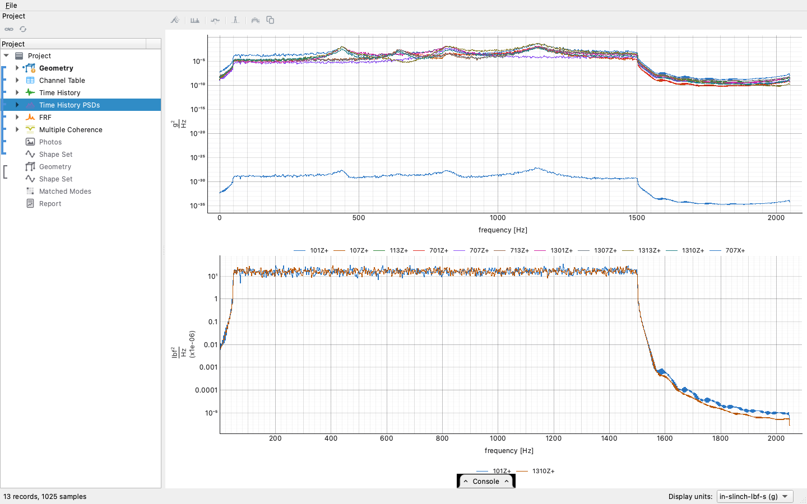

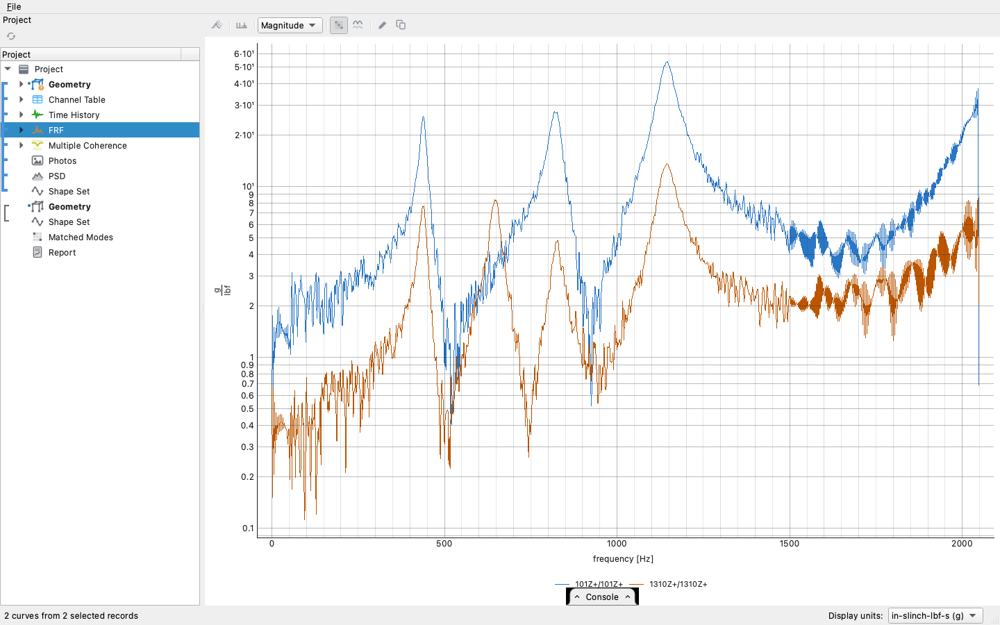

## Two things together

Hold Cmd (Ctrl on Windows and Linux) and click a second row, or pick
cells in a second grid. What the pair shows depends on what the two
objects are; a pair that has no combined reading shows each object on
its own.

### Data on a geometry

A geometry selected with one data object *moves the geometry with the
data*. The animation controls appear on the bar: play and pause,
faster and slower, the scale, and a cursor on the plot below that the
scene follows.

| geometry + | the scene shows |
| --- | --- |
| a shape set | The mode shape, animated; the mode box picks which mode. Every DOF of the mode that is on the geometry moves, and the status line counts the DOFs that are not. |
| a time history | The geometry deflecting sample by sample, in proportion to what each channel measured; drag the cursor on the record or press Play. |
| an FRF or a spectrum | For complex frequency data, the **operating deflection shape** at one frequency line (magnitude and phase per channel), animated; the cursor on the plot picks the line. |
| a PSD of autospectra | The **envelope**: the geometry deflected by ±√PSD, colored by decibels below the largest motion of any node at any line. It shows where the article moves most, without the phase a PSD does not have. |
| a whole CPSD | The **principal shape**: the dominant eigenvector of the cross-spectral matrix at each line, with each channel's phase relative to the others. |
| a picked reference column of a CPSD | The operating deflection shape relative to that reference, the same shape an FRF gives, from operating data. |
| a second geometry | Both overlaid, such as a test geometry over the model it was built from. |

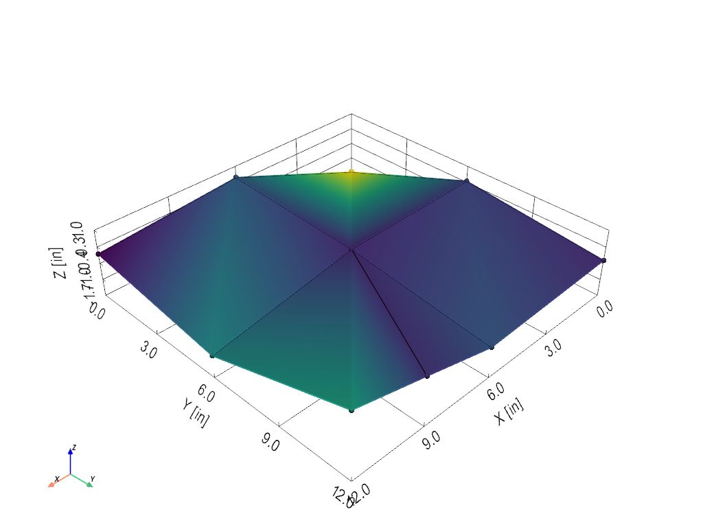

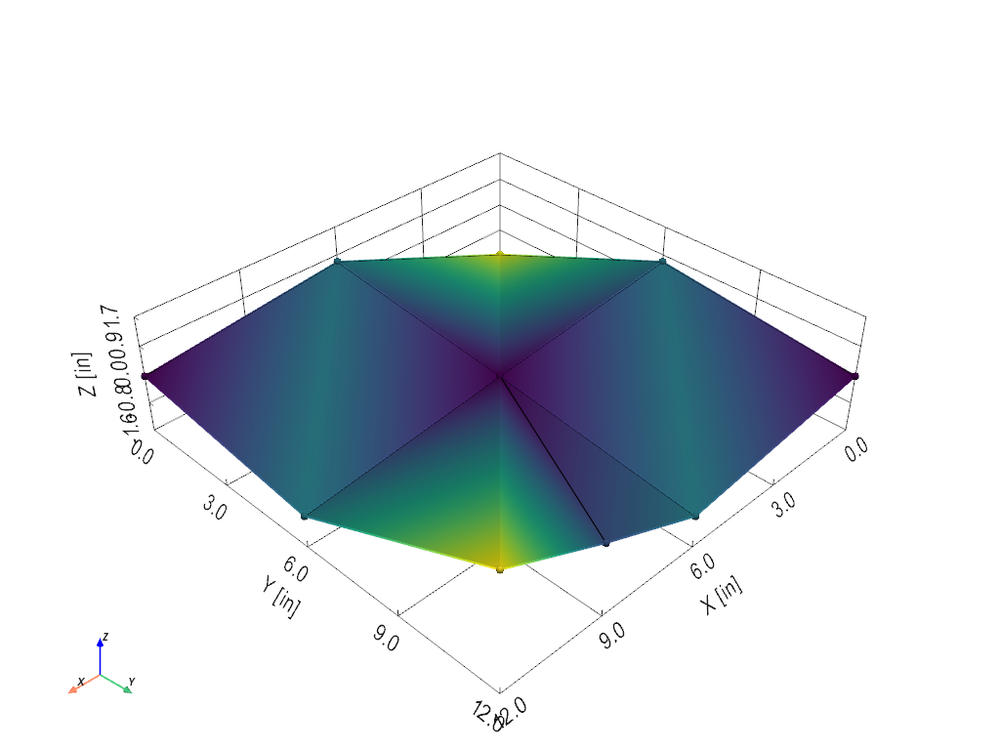

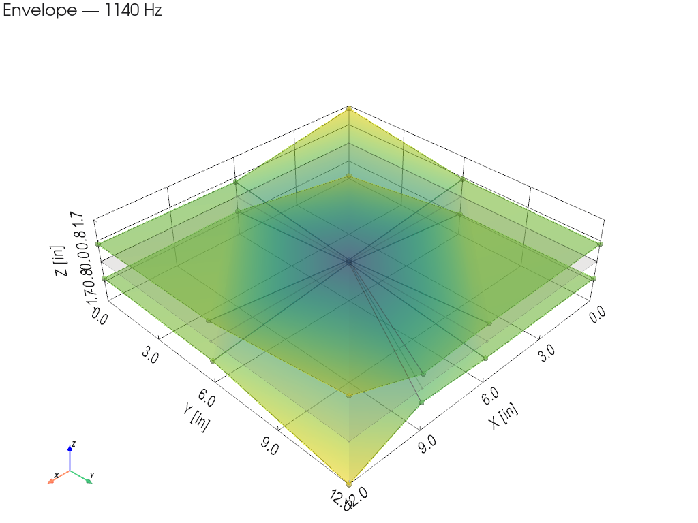

Picking records in the data object's grid limits the animation to
those records. Check *DOF arrows* on the bar to mark where each
channel is; choosing a quantity beside it marks every DOF the selected
data measures as that quantity.

### A channel table on a geometry

A channel table selected with a geometry marks where its channels are:
an arrow at each channel's node, along its direction, colored X red,
Y green and Z blue. A force channel's arrow points in to its node. The
arrows come on as soon as the two are selected, and *DOF arrows* on
the bar turns them off. The drop-down beside it picks *All channels*,
the *Control channels* (those with Control checked, whatever their
role), or only the *References*, *Responses* or *Monitors*; a choice no
channel answers is not listed. A channel with no node or direction yet, or at a
node the geometry does not have, gets no arrow, and the status line
counts them. Typing a node or a direction into the table moves its
arrow straight away, so a table started by hand can be laid out on the
model as it is filled in.

### Two shape sets

Two shape sets together give the MAC: the matrix of the two sets,
each pair's modal assurance criterion, with the sets projected onto
one geometry when they are on different geometries. Click a cell to
compare that pair. When the sets are on a geometry, *Overlay
Animation* animates the two shapes over each other, phase-aligned, and
for sets on two geometries *Animate the Projection* shows the second
set projected onto the Basis geometry instead of on its own. *Add
Matches* (the **+** on the bar) commits the selected squares to the
matched-modes object for that pair of sets.

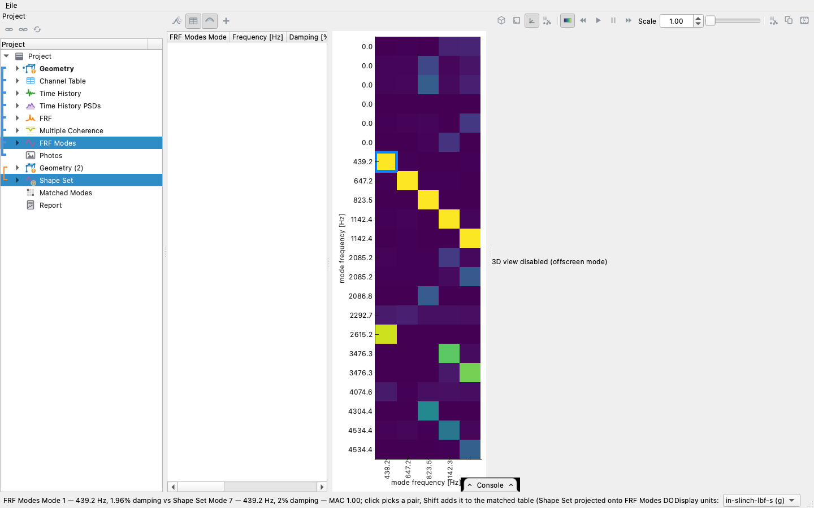

### An FRF and a shape set

An FRF beside a shape set has two readings, and the choice is kept. *Edit
Fit*, the default, opens the mode fitter on the FRF with the set as its
starting point ([How the mode fitting works](modal-fitting.md)).
*Resynthesis* draws the FRF the set predicts with the measured one, in
gray on the stage or dashed in the flat plot, so you can judge a fit
against the data it was fitted to.

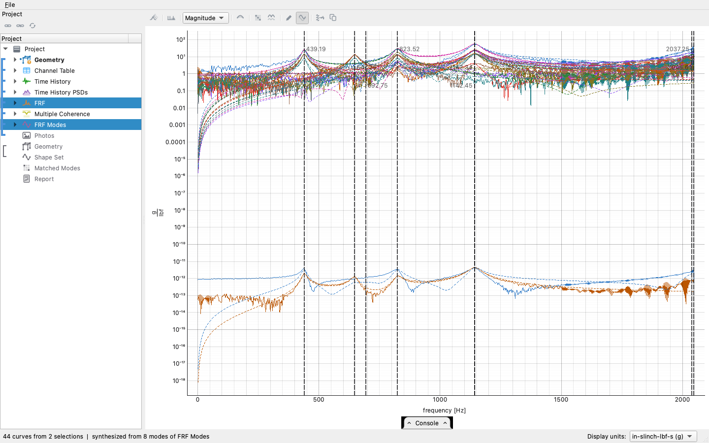

### A measurement and its requirement

A measured object selected with the requirement it had to meet is a
comparison, and a comparison has its own readings on the bar: the
spectra (on the stage with every channel and its bands, or flat one
channel at a time), bars with one number per channel, and the table
under either.

| pair | the comparison |
| --- | --- |
| PSD + specification | *Spectra*: each channel's measured spectrum against its target and bands, with the lines outside an abort limit boxed. *RMS Error*: the RMS level error per channel as bars. *Lines Out*: how much of each channel's band fell outside its abort limits. *Chance*: one channel's lines outside each band beside how many chance alone puts there at its degrees of freedom, with lines combined if asked ([Lines outside a band by chance](comparison-chance.md)). When the run was captured below full level it is compared scaled up to the specification, and the *Scaling* field on the bar shows the decibels added ([How a PSD means its area](psd-reading.md)). |
| SRS + shock specification | *Spectra*: every event of a channel against the required SRS. *SRS Error*: the RMS decibel deviation of each channel in each event, as bars. Pick one event's records and only that event is compared. |
| time history + transient specification | *Waveforms*: the measured waveform over the one it was controlled to, aligned, one repeat at a time from the event box. *Waveform Error*: how far each channel is from the target waveform in that repeat, as a share of the target. |
| sine levels + sine sweep specification | The level each tone reached against the level required, tone by tone, and the error as bars. |

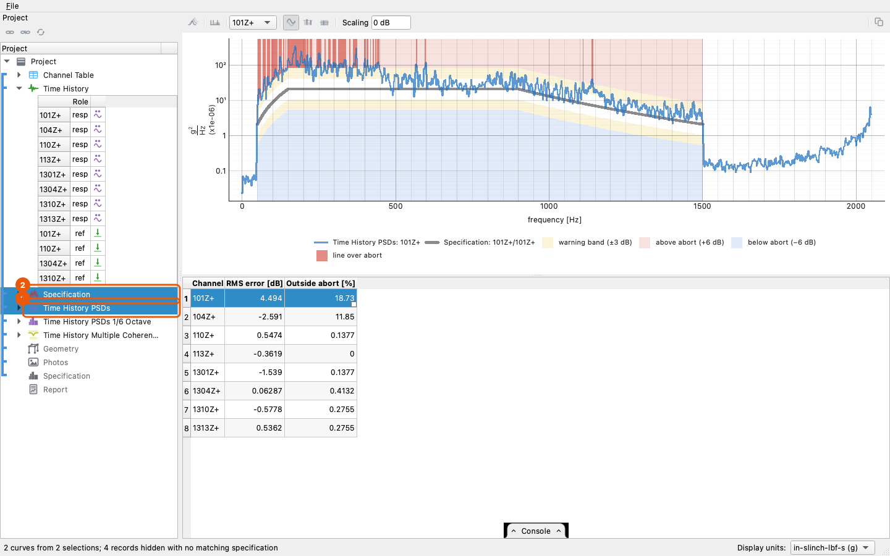

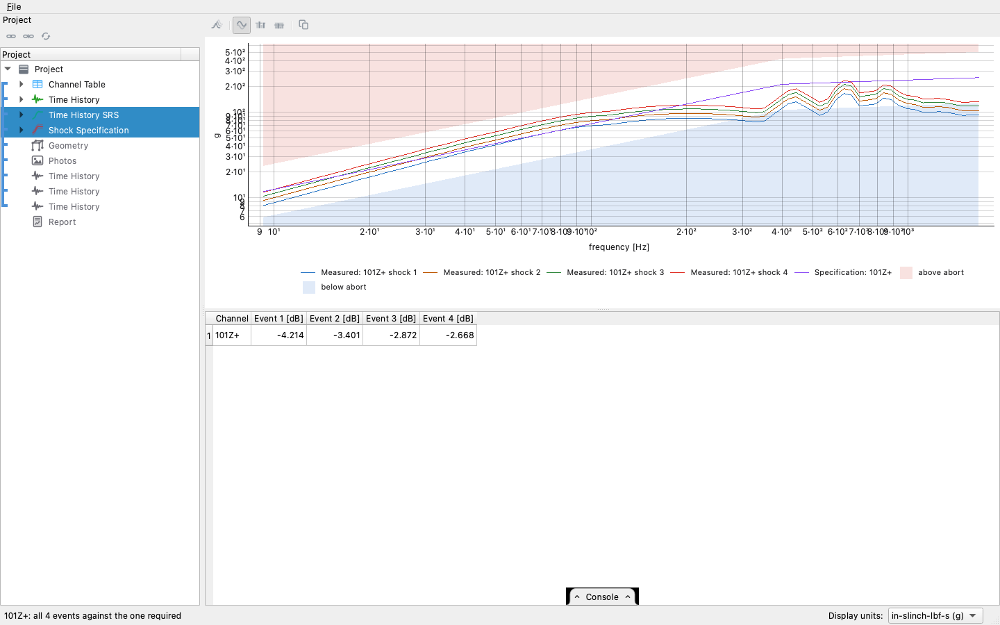

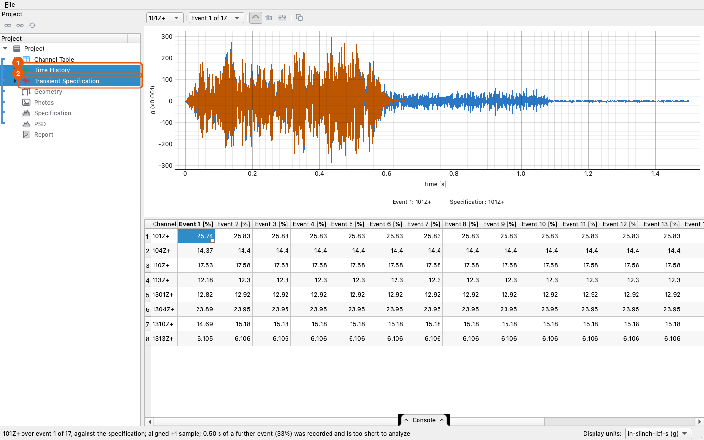

In the shock and transient comparisons, picks choose the channels: a
channel picked on the specification or on the measurement is the
channel the comparison draws, and picks on both sides have to agree. A
record and a target that share no coordinate are not compared, and the
status line says so.

### Two PSDs

Two PSD objects (neither of them a specification) read as *Overlaid*,
the two spectra over each other; *Signal to noise (dB)*, the louder
over the quieter line by line; or *RMS signal to noise*, one number
per channel as bars ([Plotting](plotting.md#two-psds-together-overlaid-or-divided)).
Two PSDs that share no channel are not compared, and the status line
says so.

### Two FRFs

Two FRF objects, such as two runs of one survey, are drawn on one
stage. Each channel is a station, matched by response and reference;
the object higher in the tree is colored by level and the other is
drawn in gray behind it. Pick one record in each object's grid to draw
just those two at a single station
([Plotting](plotting.md#two-frfs-together)).

### Everything else

Several objects of the same type and abscissa, such as two SRS or two
time histories, are drawn together on one stage, or flat as curves.
Two coherence objects open on the map. Photographs are shown beside
any selection that draws no data, and a report selected with anything
else keeps its editor up. A geometry or a shape set stays selected
while records are picked in a grid, because the records are what
animate on it; other data objects, reports and photographs give way to
a grid pick unless the modifier is held.

The acts a selection can take are on the bar as soon as the selection
allows them, decided by the same rules as the readings: a record and a
shape set offer *Transform to Modal Coordinates* (or *Expand to
Physical Responses* for modal data), two shape sets on two geometries offer
*Project onto Basis DOFs*, and objects of one type that can be merged
offer *Merge into One* ([Projects, links, and the
Basis](projects.md#merging)).
