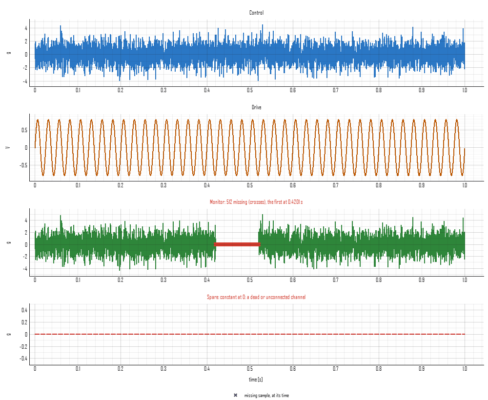

# Importing a time history from delimited text

The commonest way a recorded test leaves the machine that recorded it
is a text file with one column per channel: a controller's export, a
recorder's, a spreadsheet saved as CSV. Each program lays its file out
its own way, so Visual Dynamics finds the layout, shows it, and takes
anything it found as stated instead when it is wrong.
`visualdynamics.io.delimited` is the reader; `import_file` uses it for
any `.csv`, `.tsv`, `.txt`, `.tab`, `.asc` or `.prn` file whose lines
end in columns of numbers.

```python
import visualdynamics

history = visualdynamics.import_file('run.csv')
history = visualdynamics.import_file('run.txt', time_column=False,
                                     sample_rate=5120, units='g',
                                     names=['101Z+', '102Z+'])
```

## What is found

`visualdynamics.io.delimited.text_layout(path)` returns what the reader
found, as a `TextLayout`:

| Part | How it is found | Stated as |
|---|---|---|
| delimiter | tab, semicolon, comma, pipe or a run of spaces: whichever splits the last lines into the same number of numeric fields | `delimiter=` |
| decimal point | a comma when a file split by anything but a comma writes `0,25` | `decimal=` |
| data | from the first two lines in a row that split into that many numbers | `data_line=` |
| names | the line directly above the data; a unit may ride in a name as `Accel (g)` or `Accel [g]` | `names_line=` |
| units | a line between the names and the data whose every field reads as a unit | `units_line=` |
| sample rate | a preamble line such as `Sample Rate: 5120`, `fs = 5.12 kHz` or `dt, 1.953125e-4` | `sample_rate=` |
| time column | a column named `Time`, `t`, `Seconds`, `X_Value` and the like; in a file with no names, a first column that rises in an even step | `time_column=` (an index, a name, or `False` for none) |

Line numbers count from 1, as an editor numbers them. A time column
with no unit is read as seconds, and the import says so with the
sample rate that gives.

## The sampling

A time history needs an even step, and a text file can get it from
three places: the time column, a preamble, or the person importing it.
When two of them are given and disagree, the import is refused: one of
them is wrong, and the file cannot say which.

A time column written to a fixed number of places steps unevenly by a
unit of its last digit. 1/5120 s written to six places is 0.000195,
then 0.000391, then 0.000586: steps of 0.000195 and 0.000196 seconds.
When every time lies within the rounding of its own digits of an even
step, the even step is taken and the import says so. A column uneven by
more than that, or out of order, is refused with the reason, and if the
rows were in fact sampled evenly they can be read without it:
`time_column=False` with the `sample_rate`.

## Channels, names and units

Every column but the time column is a channel, or the ones `columns=`
names, in the order named. A channel's name is its header, or
`column 3` counted from 1 for a file with no names. A name that is a
DOF (`101X+`, `101z`) becomes the record's response DOF; any other name
labels the record and leaves its DOF empty, to be set in the channel
table. `names=` renames the channels.

A unit from the header is declared, and the values converted to SI,
when it reads as something a channel measures. One that does not is
left undeclared, the channel holding the file's numbers, and the import
says why: `counts` and `bananas` are not units this package reads, and
`Gs` reads as gigaseconds, a time, which no channel of a time history
measures. Values are never scaled by a guess. `units=` states a unit
for every channel, one per channel, or `{name: unit}`, and a stated unit
that cannot be declared is refused rather than noted. `quantities=`
says what a channel measures without giving its unit
(`'acceleration'`, `'displacement'`): it labels the channel and narrows
the units offered later, and scales nothing. A unit that contradicts a
stated quantity is refused.

## Missing samples and dead channels

An empty cell, `NaN` or `N/A` is a missing sample. It is kept as NaN,
and the import names the channel, how many samples are missing and
where the first falls; `missing='refuse'` refuses the file at the first
one instead. A row shorter than the header is read with its missing
cells and noted. A channel whose every sample is one value is noted as
dead, with that value in the unit the file wrote it in. Nothing is
dropped: what the file holds is imported, and the notes say what is
wrong with it. `visualdynamics.core.channel_health` makes the same
findings for any time history.

## What is refused

Each refusal says what was found and where:

- a cell that is not a number, by line and column name (a date or a
  clock time is named as one, with the way round it);
- a row with more fields than the data above it;
- a file with neither a time column nor a sample rate, naming its
  columns;
- a time column out of order, or uneven beyond its digits;
- two sample rates that disagree;
- a stated unit or quantity that cannot be used, a header unit that
  contradicts a stated quantity, and a column named that is not there.

## The preview



`plot_import_preview` draws each channel as read, in a row of its own
against time, titled with its label and what was found in it. A missing
sample has no value to draw, so it is a cross on the row's zero line at
its time; a dead channel is drawn dashed. The figure is a recorder's
export with a stated rate of 5,120 samples a second and its time
written to six places: the import notes the rounded time column, the
monitor's 512 missing samples from 0.42 s, and the spare channel
constant at 0 g.

```python
visualdynamics.plot.plot_import_preview('run.csv', path='preview.png')
```

## In the app

Importing a delimited text file (File → Import, or a drop) opens a
dialog on what was found: the delimiter, the decimal point, the time
column and the sample rate, and a table of the channels with a box to
keep each, its name and its unit. The same preview is drawn under it,
read from the head of the file by the same call the import makes, with
the notes below it; a refusal is shown in their place and Import is not
offered until it is put right. Import then reads the whole file with
what was set, and the journal records the call a script would make,
holding only what differs from what was found:
`project.import_file('run.csv', sample_rate=5120.0)`.

## Writing one back

A time history exports as a `.csv` (`export_file(history, 'run.csv')`):
a line naming what it holds, a header of `time (s)` and one column per
record named by its label with its unit in brackets, and every value to
the digits that read back as the same number. With a unit system chosen
the records are in its units, g included; without one, in SI. The
reader takes the file back with its names, DOFs, units and sample rate.
