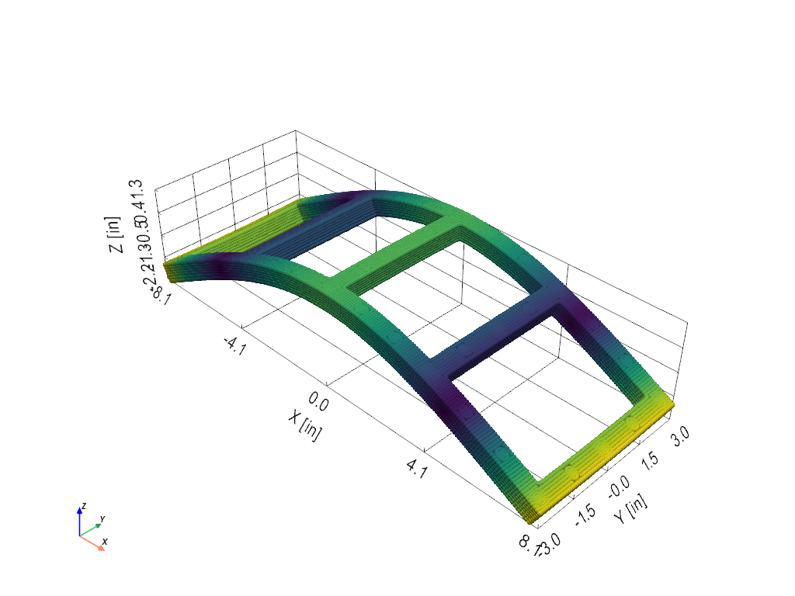

# The solid workflow: the Frame-Wing

This page builds a finite element model of solid bricks in the app, in
the same order a part is drawn in CAD: solid shapes are added, copied in
rows, subtracted and joined, then meshed; the parts are bolted together
by merging nodes, and the model is solved. Everything on this page is
done with the mouse and the keyboard, and the demonstration module
builds the same models with the same steps.

The structure is the Frame-Wing, a small aluminum frame with two wings
that the structural dynamics community shares as a test article for
substructuring. The frame is a 16 by 6 in ladder cut from half-inch
plate, with two rails and five uprights half an inch wide and 41
threaded steel inserts to bolt things to. The two wings are rectangular,
22 by 4.385 in, one thin (1/8 in) and one thick (1/4 in), and either
screws across two of the frame's uprights. Its solid models, finite
element models and test data are shared on the SEM Dynamic
Substructuring Focus Group wiki,
<https://wiki.sem.org/wiki/Round_Robin_Frame_Structure>. Every dimension
below was read off the finite element models shared there.

A half-inch bar spanning a 100 mm window is neither a beam nor a plate.
The [BARC](fem-workflow.md) is built from planes of plate elements
because its walls are thin. This frame is built from eight-node solid
bricks with incompatible bending modes, so a single brick through a
plate's thickness bends the way the plate does.

```python
from visualdynamics.demo import frame_wing

frame_wing.project().save('frame-wing.vdyn')    # the five models this page builds
```

The project's journal (the console) records this page's steps, one line
per click.

| Step | Where | How |
|---|---|---|
| Start a geometry | the project row's bar | **+** *New Geometry* |
| Add the shapes | the geometry's **Solids** row | *Add Block*, *Add Cylinder*, *Add Cone*, *Add Sphere*, *Add Section*, *Add Plate*, *Add Disk* |
| Pattern them in rows | solids picked in the tree | *Pattern* |
| Cut and join them | solids picked in the tree | *Subtract*, *Union* |
| Mesh | parts picked in the tree | *Mesh Solids* |
| Bolt a wing on | element groups picked in the tree | *Mate Surfaces* |
| Give each part its material | the pencil on an element group's row | the Element Groups table |
| Solve | the geometry's 3-D view bar | *Modes*, then *Solve Modes* in the pane |

## 1. The frame, as solids

Choose the inch system in the unit menu, select the project's row and
press **+** (*New Geometry*), then rename the new geometry *Frame*.
Select its **Solids** row and add each shape below with *Add Solid
Block* or *Add Cylinder*. The pane beside the 3-D view takes a center,
the size (three widths and a corner radius for a block, or a radius and
a length along Z for a cylinder) and a name. It draws the shape as you
type, and **Add** puts it in the tree.

| Shape | Add | Center | Size | Name |
|---|---|---|---|---|
| plate | Block | (0, 0, −0.25) | 16 × 6 × 0.5 | frame |
| window | Block | (−5.8125, 0, −0.25) | 3.375 × 5 × 1, corner 0.138 | |
| rail hole | Cylinder | (−7.75, −2.75, −0.25) | radius 0.1451, length 1 | |
| upright hole | Cylinder | (−7.75, −1.375, −0.25) | radius 0.1451, length 1 | |

The window is deeper than the plate so that it cuts all the way through.
Its corner radius rounds its four edges along Z, so once it is cut from
the plate it leaves the 0.138 in fillets the frame has in each window's
corners. Without the fillets, the frame's in-plane modes come out 8 %
low.


Then pattern the shapes. Pick a solid in the tree and press *Pattern*.
The pane asks how many copies along X, Y and Z, counting the original,
and how far apart, and draws the copies as you type. **Pattern** makes
one solid, the pattern, with the original under it in the tree, and
picks the pattern for the next step. The copies follow the original:
the original's pencil changes every copy, and the pattern's own pencil
changes how many there are and how far apart. One pattern can be a
whole grid, so all 26 rail holes are one hole patterned 13 along X by 2
along Y.

| Pick | How many along X, Y, Z | Spacing along X, Y, Z |
|---|---|---|
| the window | 4, 1, 1 | 3.875, 0, 0 |
| the rail hole | 13, 2, 1 | 1.291667, 5.5, 0 |
| the upright hole | 5, 3, 1 | 3.875, 1.375, 0 |


That gives four windows, 26 holes along the rails and 15 down the
uprights (41 holes in all), in three patterns. Now pick the plate and
the three patterns (click the plate, then Shift-click the last pattern)
and press *Subtract*. Subtract takes the other solids from the first one
in the tree, here the plate, and its tooltip names which one that is.
The result is named for the plate, *frame*. *Union* makes the picked
solids one, *Intersect* keeps only what they share, and *Take Apart*
undoes a boolean or a pattern so its solids stand on their own again.


The inserts fill the top 5/16 in of each hole. Add the same two
cylinders again, centered a little higher and shorter, named *inserts*,
and pattern them the same way as the holes:

| Shape | Add | Center | Size | Name |
|---|---|---|---|---|
| rail insert | Cylinder | (−7.75, −2.75, −0.15625) | radius 0.1451, length 0.3125 | inserts |
| upright insert | Cylinder | (−7.75, −1.375, −0.15625) | radius 0.1451, length 0.3125 | inserts |

Pick the two patterns and press *Union* to make one part, *inserts*.


## 2. Mesh

Pick *frame* and *inserts* in the tree and press *Mesh Solids*. Leave
*Elements* on *Hexes*: the frame is an extrusion along Z, which is
what bricks mesh best. Type 0.083334 for the element size (a twelfth
of an inch, which is six bricks across a member and three across a
hole) and press **Mesh**. The twelfth
is rounded up in its last place on purpose: a span that falls exactly
halfway between two brick counts then takes the count this model was
checked with, where 0.083333 would give some of them one brick more. The pane
opens on half the thinnest feature as its size. Each part becomes
an element group under **Hexes**, and the two share their nodes around
each hole. Each hole is meshed as rings of bricks about its circle, with
a square core where an insert fills it, and the fillets are rounded. The
frame comes out at 33,320 bricks and 45,087 nodes. If you change a solid
and press *Mesh Solids* again, each part's new bricks replace its
earlier mesh, and its element group and material are kept.


## 3. Materials and solve

Select the element groups' rows in the tree (Shift-click to take them
all) and click the pencil on one of them: the Element Groups table opens
with a column for each group selected. An element group of solids takes a material
and nothing else.

| Element group | Material |
|---|---|
| frame | 6061-T6 |
| inserts | typed: modulus 1.1216e6 psi, density 3.6175e-4 lbf·s²/in⁴, Poisson's ratio 0.3 |


The inserts' numbers are the shared model's: a stiffness tuned to the
tested frames and a density that gives the frame its measured mass,
spread from the insert's annulus over its whole hole. Select the
geometry, turn on *Modes* and press *Solve Modes* in the pane. It
solves in about half a minute,
with six rigid-body modes at 0 Hz followed by the elastic modes.



## 4. The wings

Each wing alone is a geometry of its own: a plate with eighteen holes,
made by 1 in long cylinders through it. For the thick wing (the thin
one is the same with 0.1243 for the thickness and 0.08975 for every Z):

| Shape | Add | Center | Size | Name |
|---|---|---|---|---|
| wing | Block | (1.9375, 0, 0.15575) | 4.385 × 22 × 0.2563 | thick wing |
| screw hole | Cylinder | (0, −2.75, 0.15575) | radius 0.1043, length 1 | |
| rail hole | Cylinder | (1.2917, −2.75, 0.15575) | radius 0.1043, length 1 | |
| end hole | Cylinder | (0.5626, −7.75, 0.15575) | radius 0.1043, length 1 | |

| Pick | How many along X, Y, Z | Spacing along X, Y, Z |
|---|---|---|
| the screw hole | 2, 5, 1 | 3.875, 1.375, 0 |
| the rail hole | 2, 2, 1 | 1.291667, 5.5, 0 |
| the end hole | 2, 2, 1 | 2.75, 15.5, 0 |

Subtract the three patterns (eighteen holes) from the wing, mesh it at
0.125, and give it 6061-T6. The wing's underside is 0.0276 in above
the plane of the frame's top (z = 0), the thickness of the washers that
go under it on the frame.

## 5. A wing bolted to the frame

The wing on the frame is one geometry. Before meshing the *Frame*
geometry, copy it (Copy, then Paste on the project) and rename the copy
*Thick Wing on Frame*. In the copy, add the screws, then repeat the
wing's steps, then bolt the two together.

### The screws

Each screw is threaded into the insert under it, and the steel there is
what makes the joint stiff. In the copy, add a cylinder over one insert
at a screw, named *screws*, and pattern it into four. The pattern takes
the cylinder's name, *screws*:

| Shape | Add | Center | Size | Name |
|---|---|---|---|---|
| screw | Cylinder | (0, −2.75, −0.15625) | radius 0.1451, length 0.3125 | screws |

| Pick | How many along X, Y, Z | Spacing along X, Y, Z |
|---|---|---|
| the screw | 2, 2, 1 | 3.875, 5.5, 0 |

Then mesh *frame*, *inserts* and *screws* together at 0.083334. Where
two parts overlap, the later one in the tree takes the bricks, so the
four inserts under the screws become steel.

### The wing and its washers

Add the wing's shapes (section 4), and a washer under the wing at each
screw, patterned the same way as the screws:

| Shape | Add | Center | Size | Name |
|---|---|---|---|---|
| washer | Cylinder | (0, −2.75, 0.0138) | radius 0.196, length 0.0276 | washers |

| Pick | How many along X, Y, Z | Spacing along X, Y, Z |
|---|---|---|
| the washer | 2, 2, 1 | 3.875, 5.5, 0 |

Pick the wing and the washers, press *Mesh Solids*, type 0.125, tick
**Keep apart from other groups**, and press **Mesh**. The washers share
nodes with the wing above them, and their undersides lie on the frame's
top without sharing any node with it.

### Bolting

The washers and the frame were meshed separately, so their nodes do not
line up, and they do not need to. Under **Hexes**, pick the element
groups *frame*, *inserts*, *screws* and *washers* and press *Mate
Surfaces*. Each washer's underside rests partly on its screw and partly
on the frame around it, so the pane lists eight patches, two at each
washer, and marks them all. Click the first in the list and Shift-click
the last to pick all eight, leave **Normal** and **Shear** on *Rigid*,
and press **Keep**. Each patch becomes a joint under the geometry's
**Mated Surfaces** row, and the wing is bolted on: each node on one side
is held to the point of the other side's surface beneath it, so the two
meshes need not match.


A joint can be made softer than rigid. Its pencil opens it again, where
**Normal** and **Shear** each take *Stiffness* and a value per node, which
is how a bolted joint is tuned to match measured modes.

### The screws' heads

The rest of each screw's mass, its head and the washer under the head,
sits on the wing's top. Click the pencil on the **Points** row, switch
on add mode (**+**), choose *New element group*, and click the node of
the wing's top nearest each screw. Name the group *screw heads* and give
it a mass of 1.9986e-5 lbf·s²/in (3.5 g) in the Element Groups table.
Give *screws* and *washers* 1018 steel.

Select the geometry and press *Solve Modes* in the Modes pane. The thick wing on the frame
has 65,585 nodes and solves in under a minute.

## Sections, tubes and holes

The frame is a block with holes, but a fixture or a stand is more often
built from rolled shapes. *Add Section* on the **Solids** row adds one
as a single solid. Pick the shape (I-beam, channel, tee, angle,
rectangular tube or round tube), type its dimensions and a length, and
it runs that length along its own Z, and can be turned like any other
solid. The dimensions are the same ones the beam element's sections
take, so a channel is its depth, flange width, flange thickness and web
thickness:

| Shape | Dimensions | Laid across its own axes |
|---|---|---|
| I-beam, tee | depth, flange width, flange thickness, web thickness | depth along Y, flange along X; a tee's flange at +Y |
| channel | the same | the web at −X, the flanges running to +X |
| angle | long leg, short leg, thickness | the heel at −X, −Y, the long leg along X |
| rectangular tube | width, height, wall | width along X, height along Y |
| round tube | outer diameter, wall | |

A section's center is the middle of the box it fills. Its pencil opens
the pane on its dimensions, so making a beam deeper is one number
changed. A section meshes the way the blocks it is made of would: its
flat faces on grid lines, and a round tube as a ring.

A hole is a cylinder subtracted from the part, as the frame's are, and a
counterbore is a second, wider and shorter cylinder at its entry. A
script can add a hole in one call: `add_solid_hole` takes the center
where it enters and runs down its own Z, through the part it is cut
from when no depth is given, and stays through if that part is made
thicker. Pick the part and the hole and subtract as before:

```python
import visualdynamics

project = visualdynamics.Project('Stand')
project.new_geometry('Stand', unit='in')
beam = project.add_solid_section('Stand', 'I-beam', (0, 0, 12), (4, 2, 0.25, 0.2),
                                 24, unit='in')
plate = project.add_solid_block('Stand', (0, 0, -0.25), (8, 8, 0.5), unit='in')
hole = project.add_solid_hole('Stand', (3, 3, 0), 0.25, counterbore=(0.44, 0.19),
                              unit='in')
base = project.combine_solids('Stand', 'subtract', [plate, hole])
```

## What was checked

The model was checked three ways.

### The element

The finite element model of the frame shared on the wiki was read with
the Nastran importer and solved in Visual Dynamics. Its first ten
elastic modes match the ones MSC Nastran gives for the same mesh to
within 0.1 %, which checks the brick element and the sparse solver
separately from the meshing.

### The frame and the wings, against test

The wiki lists the first nine modes of five frames, which differ from
each other by up to 5 %. The frame built here is within 1 % of frame
SN003 on six of those modes and within 4 % on the three in-plane modes.
The wings' frequencies were fitted from the shared test FRFs with *Fit
Modes*: the thin wing is within 1 % on every mode, and the thick wing
within 3 %.

| Frame mode | Measured, SN003 | Built here |
|---|---|---|
| 1 | 234.2 | 235.1 |
| 2 | 291.7 | 291.7 |
| 3 | 624.4 | 628.8 |
| 4 | 652.8 | 652.9 |
| 5 | 715.3 | 696.0 |
| 6 | 752.0 | 725.1 |
| 7 | 1118.8 | 1124.5 |
| 8 | 1155.3 | 1160.9 |
| 9 | 1241.3 | 1214.6 |

### The wings on the frame, against the shared models

Finite element models of the same assemblies are shared on the wiki,
tuned there to test (Linderholt, 2024). Each of the first nine modes
built here is within 3 % of them. The shared models join each wing with
rigid links between the screws' parts, which their author notes may
make them slightly stiffer.

| Mode | Thick wing on frame, shared | Built here | Thin wing on frame, shared | Built here |
|---|---|---|---|---|
| 1 | 126.0 | 124.5 | 63.8 | 62.3 |
| 2 | 233.4 | 239.3 | 113.5 | 111.6 |
| 3 | 242.7 | 241.1 | 224.4 | 222.6 |
| 4 | 312.4 | 308.7 | 224.8 | 225.2 |
| 5 | 439.3 | 438.0 | 268.6 | 270.4 |
| 6 | 454.3 | 451.2 | 306.2 | 302.7 |
| 7 | 460.8 | 464.9 | 373.0 | 366.0 |
| 8 | 645.1 | 651.5 | 417.2 | 410.8 |
| 9 | 676.5 | 678.1 | 497.2 | 491.5 |

The steel screw threaded into the insert, as on the hardware, matters:
with only a washer mated onto the insert's spread-out material, the
thick wing's first mode reads 7 % low. No property was adjusted to bring
these numbers closer. None of the wiki's files are in this package or
its examples; the numbers above are the values read from them.

From a script:

```python
from visualdynamics.demo import frame_wing

model = frame_wing.build()                         # the frame alone
shapes = model.eigensolution(maximum_frequency=1500)
print(shapes.frequency[6:15])                      # the first nine elastic modes
both = frame_wing.build('thick wing')              # the frame with a wing on it
```
