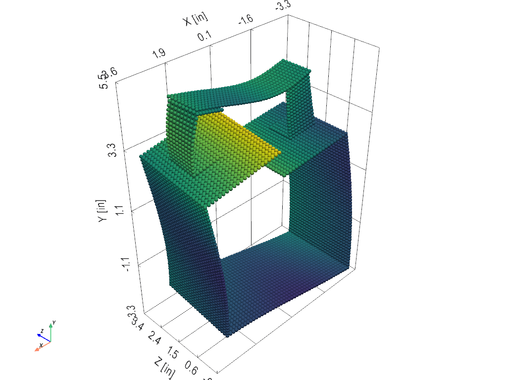

# The finite element workflow: the BARC

This page builds a finite element model of plates in the app: the
planes a structure is made of, tied together where it is bolted, then
solved. Further down, the same structure is [built again from solid
bricks](#the-barc-from-bricks-bolted-by-merging-nodes), with its parts
meshed separately and each bolt made by merging the nodes it clamps.
For a part too thick for plates, [the solid workflow](fem-solids.md)
builds the Frame-Wing from solid shapes and meshes them into bricks.

The structure is the BARC (Box Assembly with Removable Component), a
small bolted aluminum article the structural dynamics community shares
as a common test piece. It is a square box tube whose top wall is
slotted in two, with the *Bench* on top: two channels standing on the
two halves and a flat bar bolted across their tops. Its solid model, test
data and finite element models are shared on the SEM Dynamic
Substructuring Focus Group wiki, <https://wiki.sem.org/wiki/BARC>. Every
dimension below comes from that solid model, and the model was checked
against the finite element models shared there.

Every step is done in the app. The whole model is also a demonstration
module, `visualdynamics.demo.barc`, so you can check each step against
it or skip ahead:

```python
from visualdynamics.demo import barc

barc.project().save('barc.vdyn')    # the model this page builds, already built
```

| Step | Where | How |
|---|---|---|
| Start a geometry | the project row's bar | **+** *New Geometry* |
| Build it from planes | the geometry's **Quads** row | *Add Plane*, once per plane |
| Tie the bolted parts | the geometry's Quads | pick the elements under each washer, *Tie* to the part below |
| Give each part its material and thickness | the pencil on each element group's row | pick a material, type a thickness |
| Solve | the bar | *Solve Modes* |

## 1. The geometry, from planes

The simplest description of a plate model is its planes. Each plane is
a rectangle at the plate's mid-thickness, given as a corner, two edges
and an element size. Each edge is divided evenly into the whole number
of elements nearest that size, so the elements come out close to
square. Where a new plane's nodes fall on nodes already in the geometry,
they become those nodes, so planes that meet along a line (the box's
corners, a channel's web and flanges) are joined there. Planes given the
same element group name are one element group: the box's five walls are
the group *box*.

Choose the inch system in the unit menu, select the project's row and
press **+** (*New Geometry*). This makes an empty geometry in inches,
named *Geometry*. Expand it, select its **Quads** row and press *Add
Plane*. A pane opens beside the 3-D view. Type each row of the table
below (element group, center, widths) with an element size of 0.125 in,
and press **Add**. A plate leaves one width at zero, the axis it faces:
the bottom's zero width along Y puts it in the X-Z plane. The pane stays
open for the next row and draws the plate in the 3-D view as you type.
Before each Add it says how many of the plate's nodes land on nodes
already there (for example, the right wall's 25 on the bottom's edge).
You can also turn the preview about its center with the rings around it
and slide the center along its axes with the arrows, which land on a
tenth of an inch; the rows in the table do not need either.


| Plane | Element group | Center | Widths |
|---|---|---|---|
| box, bottom | box | (0, −2.875, 1.5) | (5.75, 0, 3) |
| box, right side | box | (2.875, 0, 1.5) | (0, 5.75, 3) |
| box, left side | box | (−2.875, 0, 1.5) | (0, 5.75, 3) |
| box, top left of the slot | box | (−1.5625, 2.875, 1.5) | (2.625, 0, 3) |
| box, top right of it | box | (1.5625, 2.875, 1.5) | (2.625, 0, 3) |
| right channel, foot | right channel | (1.96875, 3.0625, 1.5) | (0.9375, 0, 1) |
| right channel, top | right channel | (1.96875, 4.9375, 1.5) | (0.9375, 0, 1) |
| right channel, web | right channel | (2.4375, 4, 1.5) | (0, 1.875, 1) |
| left channel, foot | left channel | (−2, 3.0625, 1.53125) | (1, 0, 0.9375) |
| left channel, top | left channel | (−2, 4.9375, 1.53125) | (1, 0, 0.9375) |
| left channel, web | left channel | (−2, 4, 1.0625) | (1, 1.875, 0) |
| beam | beam | (0, 5.0625, 1.5) | (5, 0, 1) |

The two channels are turned a quarter turn from each other, as they are
on the hardware. The lengths are the solid model's, in inches (the
geometry stores them in SI). Up is +y, as in the solid model.


From a script, the same planes are `mesh.plane` and `mesh.assemble`, or
`project.add_plane`, which is what each Add records:

```python
import numpy as np
from visualdynamics import mesh

x, y, z = np.eye(3)
size = 0.125                                 # inches

def plate(corner, a, b, name):
    return mesh.plane(corner, a, b, size, name, unit='in')

t = 2.875                                    # the box wall's mid-surface
barc = mesh.assemble(
    plate((-t, -t, 0), 2 * t * x, 3 * z, 'box'),            # bottom
    plate((t, -t, 0), 2 * t * y, 3 * z, 'box'),             # right side
    plate((-t, -t, 0), 2 * t * y, 3 * z, 'box'),            # left side
    plate((-t, t, 0), (t - 0.25) * x, 3 * z, 'box'),        # top, left of the slot
    plate((0.25, t, 0), (t - 0.25) * x, 3 * z, 'box'),      # top, right of it
    plate((1.5, 3.0625, 1), 0.9375 * x, z, 'right channel'),       # its foot
    plate((1.5, 4.9375, 1), 0.9375 * x, z, 'right channel'),       # its top
    plate((2.4375, 3.0625, 1), 1.875 * y, z, 'right channel'),     # its web
    plate((-2.5, 3.0625, 1.0625), x, 0.9375 * z, 'left channel'),
    plate((-2.5, 4.9375, 1.0625), x, 0.9375 * z, 'left channel'),
    plate((-2.5, 3.0625, 1.0625), x, 1.875 * y, 'left channel'),
    plate((-2.5, 5.0625, 1), 5 * x, z, 'beam'),
)
```

## 2. The bolted joints

Where the parts are bolted, their mid-surfaces do not meet. A channel's
foot sits 0.1875 in above the box wall's mid-surface, so the two share
no nodes and something has to join them. That is a rigid, massless
link: a two-node line whose second node moves exactly as the first does,
carried by its rotation, with no mass added. An element group of
two-node lines given the material *rigid (massless)* is a set of these
links.

How the links are laid out is the most important modeling decision in
this model, and it was settled by comparing against the models on the
wiki. A single link at each bolt comes out soft, and softer with every
mesh refinement, because a point tie on a plate is a local singularity
and not a joint. Tying each foot over its whole area comes out stiff.
Tied over the washer's area, the model agrees with the wiki's models and
converges. The patch is made of the elements the washer covers, rather
than every node within its radius, because elements are what you pick
in the view: whole elements that can be counted.

So under each bolt, every node of the elements it clamps is tied to the
nearest node of the part below. There are sixteen bolts: four through
each channel's foot into the box, and above them four through the beam
into each channel's top. Under a foot the patch is the washer's area,
which is the element the bolt passes through and the eight around it.
Through the beam the patch is only the element the bolt passes through.
Four bolts at each end of the beam clamp as much as one bolt over its
washer would, and wider patches on all four bolts make the beam's joint
stiffer than the models on the wiki. At the 0.125 in mesh the patches
are:

| Bolts | Where, (x, z) | The elements under each | Tie to |
|---|---|---|---|
| left foot | (−2.1875, 1.3125), (−2.1875, 1.6875), (−1.8125, 1.3125), (−1.8125, 1.6875) | the element the bolt passes through and the eight around it | box |
| right foot | (1.8125, 1.3125), (1.8125, 1.6875), (2.1875, 1.3125), (2.1875, 1.6875) | the element the bolt passes through and the eight around it | box |
| beam, left end | the left foot's four, (x, z) | the element the bolt passes through | left channel |
| beam, right end | the right foot's four, (x, z) | the element the bolt passes through | right channel |

A foot's mesh is 8 × 8, and its four patches are the 6 × 6 inside its
outer ring of elements, split into four 3 × 3 squares. On the beam, the
bolts are directly above the feet's bolts, each in the middle of one
element.

In the app, expand the geometry and click the pencil on **Quads**. For
each bolt, click one element of its patch in the 3-D view and
Shift-click the rest (Cmd-click also works on a Mac, Ctrl-click on
Windows and Linux). Then press *Tie* on the bar and pick the part below
from its menu: *box* for a foot, *left channel* or *right channel* for
the beam. Every node of the patch is linked to the nearest node of that
part. The links go into an element group of rigid, massless links,
*ties*, which the first Tie makes and every later Tie adds to. Sixteen
Ties make the 160 links. For a joint where the nearest node of a whole
part might be the wrong one, *A second selection…* in the same menu
ties the patch to a second patch that you pick next.


The same project with every step below already done, modes solved, is
on the website's [downloads page](https://visualdynamics.org/downloads#examples),
and is `barc.project(solved=True)`.

## 3. Materials, thicknesses, solve

Expand the geometry in the tree (yours, or *BARC*), then **Quads**,
select the element groups' rows (Shift-click to take them all) and
click the pencil on one of them. The Element Groups table opens with a
row for each group selected and, to the right of Name and Elements, the
property columns in the display units.

| Element group | Material | Thickness |
|---|---|---|
| box | 6061-T6 | 0.25 in |
| right channel, left channel, beam | 6061-T6 | 0.125 in |
| ties (*bolts* in the demo's BARC) | rigid (massless), set by Tie | — |

Picking a material from the drop-down fills in its modulus, Poisson's
ratio and density; you can type over any of them.


Select the geometry and press *Solve Modes*. It asks for the highest
frequency to solve for (type 2000 Hz) and the damping to give every mode
(2 % of critical by default). The model has 5,470 nodes, 5,136 plates
and 160 rigid links, and a mass of 0.820 kg; the solid model's volumes
give 0.816 kg, the difference being that the plates have no bolt holes.
It solves in a few seconds, and its modes go into the geometry's group:
six rigid-body modes at 0 Hz, then the elastic modes. Planes typed from
the table above give the demo's mesh node for node, and the patches
above are the demo's element for element, so a geometry built by hand
solves to the same modes.




## What was checked

The model's modes were checked against the finite element models shared
on the [wiki](https://wiki.sem.org/wiki/BARC), and the joints described
above are the ones that agreed with them. Those checks held the beam by
one bolt at each end. With the four bolts used here, each over the
element it passes through, the first ten elastic modes move by 0.2 % at
most and keep their shapes. The model is not tuned toward any one of the
shared models, since a model tuned to agree is no longer a check. To
compare against a measurement of a particular unit, measure that unit
and model what was measured: hardware differs from its drawing, the
box's wall thickness most of all.

From a script:

```python
from visualdynamics.demo import barc

model = barc.build()
shapes = model.eigensolution(maximum_frequency=2000)
print(shapes.frequency[6:16])                 # the first ten elastic modes
```

## The BARC from bricks, bolted by merging nodes

The same structure is also built from solid bricks, the same way the
[Frame-Wing](fem-solids.md) is: each part made from solid shapes,
blocks cut and joined, then meshed into eight-node bricks. This is the
higher-fidelity model, and the removable component (the two channels
and the beam) comes with it as a model of its own.

```python
from visualdynamics.demo import barc

barc.solid_project(solved=True).save('barc-bricks.vdyn')  # both, solved
```

Bricks touch where the parts touch: a channel's foot sits flat on the
box's top wall, and the beam sits flat on the channels' tops. So the
bolts are built without links. Each part is meshed with its own nodes,
which lie on the next part's nodes where the two touch but are joined to
none of them. Each bolt is then made by merging the nodes it clamps into
one, a place at a time, with *Merge Coincident Nodes*. Everywhere else
the parts touch, the nodes stay in pairs, free to separate, as the parts
are between their bolts.

### 1. The parts, as solids

Choose the inch system, start a geometry (**+** on the project's row),
and select its **Solids** row. Add each block below with *Add Solid
Block*: the pane takes the block's center, its three widths and a name,
and draws it as you type. Each part is made of as few blocks as it can
be. The box is one block less its inside and the slot in its top, a
channel is one block less the inside of its C, and the beam is one
block. These are the parts' true outlines, not their mid-surfaces: the
box is 6 in square outside, a foot's underside is the box's top face at
y = 3, and the beam's underside is the channels' top faces at y = 5.

| Block | Center | Widths | Name |
|---|---|---|---|
| the box | (0, 0, 1.5) | 6 × 6 × 3 | box |
| its inside | (0, 0, 1.5) | 5.5 × 5.5 × 4 | |
| the slot in its top | (0, 2.8125, 1.5) | 0.5 × 0.625 × 4 | |
| right channel | (2, 4, 1.5) | 1 × 2 × 1 | right channel |
| its inside | (1.8125, 4, 1.5) | 1.125 × 1.75 × 1.5 | |
| left channel | (−2, 4, 1.5) | 1 × 2 × 1 | left channel |
| its inside | (−2, 4, 1.6875) | 1.5 × 1.75 × 1.125 | |
| beam | (0, 5.0625, 1.5) | 5 × 0.125 × 1 | beam |


Each inside block reaches past its part's open faces so that it cuts all
the way through. The box's inside cuts through its front and back. The
right channel's inside cuts through its inboard side, where it has no
web. The left channel is turned a quarter turn with its web at the back,
so its inside cuts through its front. Pick the box's three blocks and
press *Subtract*: the inside and the slot are taken from the box, the
first of the three in the tree, and the part keeps its name, *box*. Pick
each channel's two blocks and press *Subtract* to make one part each,
*right channel* and *left channel*. The pencil on any block opens it
again so you can change it, and its part changes with it.


Then mesh them. Pick the four parts, press *Mesh Solids*, type 0.125 for
the element size, tick **Keep the parts apart from each other**, and
press **Mesh**. The four parts are meshed on one grid, cut at every
part's faces, so where two parts touch their nodes lie on each other's
at any element size. Each part keeps its own nodes there (a channel's
foot shares none of them with the box's top face), ready for the bolts
to be merged. Meshing the parts one at a time puts each on its own grid,
and then the nodes do not line up: at a quarter inch, a channel's foot
and the box's top have no nodes in the same place.


### 2. The bolts, merged

The bolts are the same sixteen as in the plate model, at the same
(x, z): four through each foot into the box and four through the beam
into each channel's top. Each bolt merges the places it clamps, by the
same rule the plate model's patches follow. Under a foot that is the
washer's area: the corners of the brick the bolt passes through and of
the eight around it, 4 × 4 places on the face where the parts touch.
Through the beam it is only the four corners of the brick the bolt
passes through. Merging only four places at a foot reads up to 10 %
soft against the models on the wiki and loses the ninth mode's shape.

In the tree, select the box's and the right channel's element groups
under **Hexes** (click one, then Cmd-click the other; Ctrl-click on
Windows and Linux) and press *Merge Coincident Nodes* on the bar. A pane
opens beside the view, both parts are drawn see-through, and every place
where their nodes coincide is marked: the 81 places of the foot's
underside, 9 × 9. A foot's four bolts, 4 × 4 places each, share their
middle rows and together make one 7 × 7 square, which is every place
except the foot's outer ring. Click the 32 marks around the foot's edge
to leave them out, and press **Merge**. The 49 places merged turn into
blue squares, and the 32 left out stay marked. Do the same for the box
and the left channel.


Then select the right channel and the beam. *Merge Coincident Nodes*
marks the 81 places where the beam lies on the channel's top. Press
**None** to leave them all out, click the four corners of the brick
each of the four bolts passes through (16 marks), and press **Merge**.
Repeat for the left channel and the beam. The four merges join the four
parts into one structure at 130 places.

### 3. The bolts' mass, the material, solve

The bolts are point masses, as in the shared model: one point element at
each bolt's head, on the top face of a foot or of the beam above the
bolt, in an element group given the mass in the Element Groups table's
Mass column. Click the pencil on the geometry's **Points** row and switch
on add mode (**+**). With *New element group* chosen beside it, click a
corner of the brick each foot bolt passes through on the foot's top
face; then choose *New element group* again for the beam's eight bolts.
A #8 screw at a foot is 0.00744 lb (1.927e-5 lbf·s²/in in the inch
system). The beam's bolts share the shared model's single 1/4 in screw
per channel, 0.0125 lb, so each carries 0.003125 lb
(8.094e-6 lbf·s²/in). Leaving the bolt masses out raises the first ten
modes by 1 to 7 %.

Give the box, the channels and the beam 6061-T6 in the Element Groups
table (bricks take only a material) and press *Solve Modes*. At an
eighth of an inch the assembly has 15,299 nodes and 9,440 bricks and
solves in about ten seconds. Its first ten elastic modes are within
3.4 % of a brick model that joined each foot over its whole footprint;
that model was checked against the wiki's model and test, and its
frequencies were 1 to 4 % above the measured modes. The mode shapes
stay in the same order (MAC 0.97 and up). The removable component,
built by the same steps without the box, is within 1.2 % of its checked
model.
