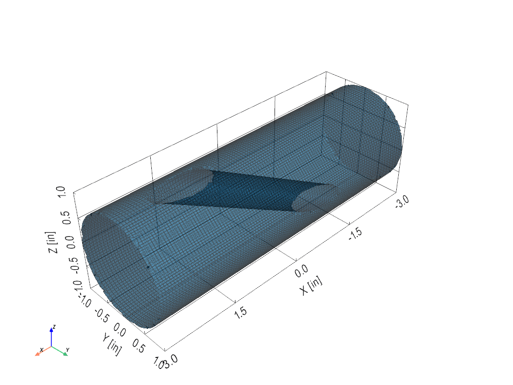
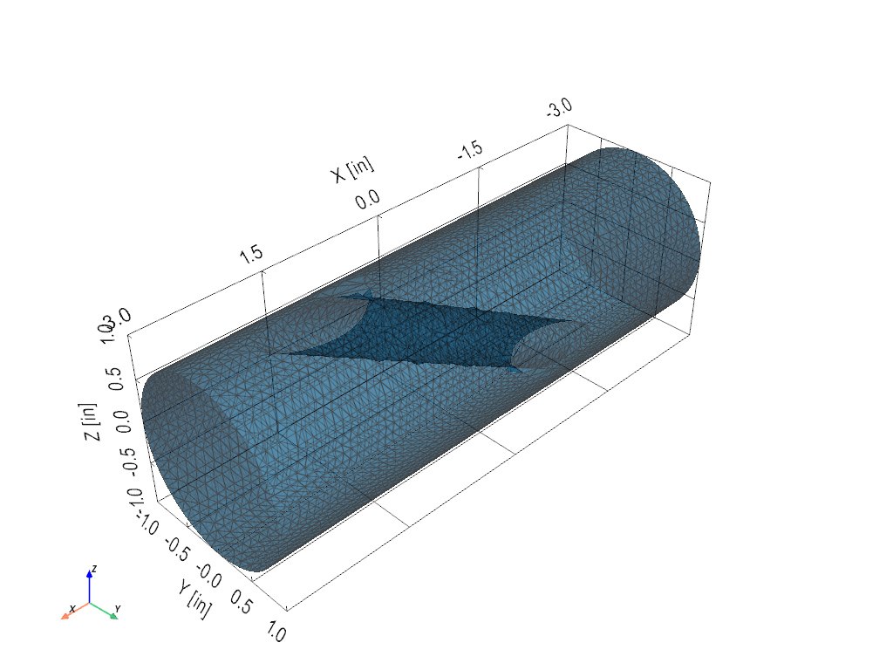
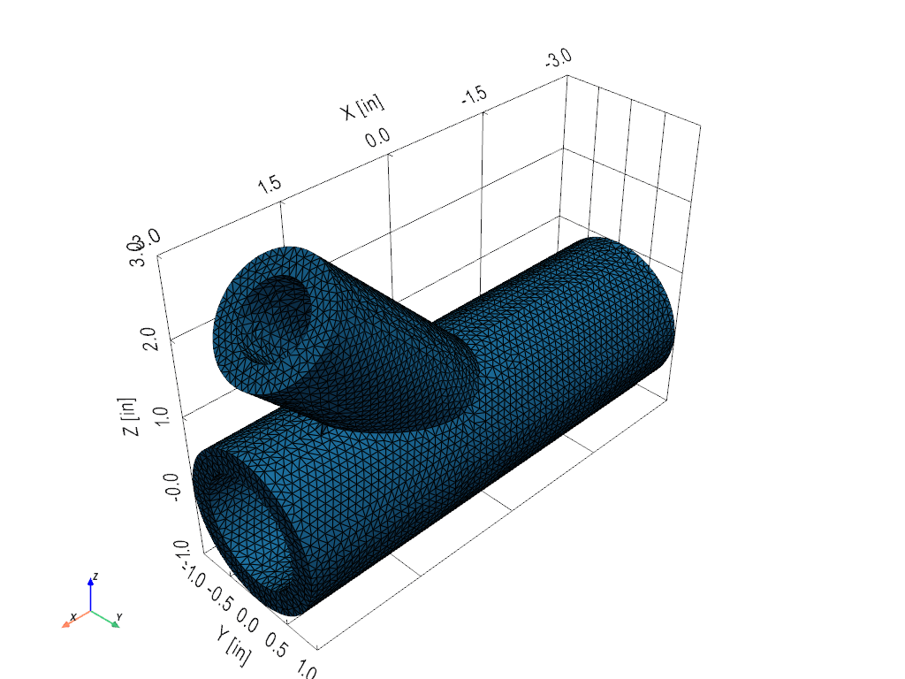
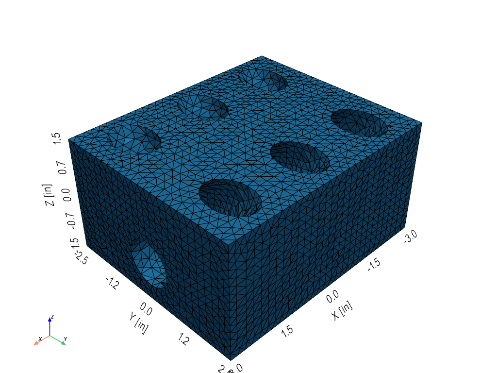

# Three shapes that are not extrusions

Mesh Solids meshes an extrusion into bricks on a grid with rings about
its holes, and that is the mesh to prefer where the part allows it.
These three shapes do not: each has a hole or a branch at an angle to
everything else, so nothing can be swept along an axis. They are here
to show what the two meshers for such shapes do today, bricks on a
grid fitted to the shape and ten-node tetrahedra, with the numbers
beside the pictures. The meshers will improve; the numbers are the
record of where they stand. Each is meshed at the size *Detect
Element Size* gives for the element type, the smallest round
feature's radius over five for bricks and over three for tetrahedra
(three through the thinnest wall for either): at those sizes the
tetrahedra mesh all three well, the fitted bricks mesh the shaft, and
on the wye and the V-block they fold a few elements and are refused
with the reason.

Each shape is built from the recipe alone, blocks and cylinders and
their booleans, by `visualdynamics.demo.shapes`:

```python
from visualdynamics.demo import shapes

project = shapes.v_block()
found = shapes.mesh(project, 'hexes')       # or 'tetras'
print(found['count'], found['quality'], found['volume_error'])
```

`shapes.report('v_block')` meshes a shape both ways at the size the
table uses, and `python -m visualdynamics.demo.shapes` prints all
three.

## How to read the table

*Worst* is the worst element in the mesh: for bricks the scaled
Jacobian, 1 for a cube and 0 for a brick flattened to nothing; for
tetrahedra the radius ratio, 1 for a regular tetrahedron and 0 for a
flat one. A solver accepts either kind down to about 0.1; a structured
ring mesh of an extrusion scores 0.5 or better everywhere, which is
why it stays the first choice. *Under 0.3* counts the elements a
careful analyst would look at. *Volume* is the mesh's, integrated the
way the solver integrates its elements, and *Recipe* is the shape's,
found by sampling two million random points over it (within a tenth
of a percent); the error between them is how much material the mesh
lost or gained in fitting the surface, mostly at curved walls. Seconds
are on a laptop, meshing alone.

## The cross-drilled shaft

A 2 in shaft, 6 in long, with a 0.6 in oil hole drilled through its
middle at 30 degrees to its axis, the way an oil passage crosses a
crankshaft. Five bricks across the hole's radius at 0.06 in, three
tetrahedra at 0.1 in.





## The wye fitting

A 2 in run, 6 in long, with a 1.5 in branch leaving it at 45 degrees,
both bored, the walls 0.3 in: five bricks across the branch bore's
radius at 0.09 in, three tetrahedra through the wall at 0.1 in. The
saddle where the branch's bore breaks into the run's is
the junction every pipe fitting has and no sweep can follow.



## The V-block

A 6 x 5 x 3 in block with a 1.2 in crank bore along its length and two
banks of three 1 in bores at 45 degrees from vertical, each bore
running from the crank bore out through the top face: a V-engine's
block with everything but the bores left out. Five bricks across a
bore's radius at 0.1 in, three tetrahedra at 0.167 in.



## The numbers

| Shape | Size (in) | Elements | Count | Worst | Under 0.3 | Volume (in³) | Recipe (in³) | Error | Seconds |
|---|---|---|---|---|---|---|---|---|---|
| Cross-drilled shaft | 0.06 | hexes | 97,534 | 0.10 | 336 | 17.73 | 17.75 | -0.12 % | 33 |
| Cross-drilled shaft | 0.1 | tetras | 193,621 | 0.10 | 1,193 | 17.73 | 17.75 | -0.11 % | 12 |
| Wye fitting | 0.09 | hexes | refused: 9 bricks folded | | | | 11.82 | | 18 |
| Wye fitting | 0.1 | tetras | 112,199 | 0.10 | 581 | 11.80 | 11.82 | -0.15 % | 21 |
| V-block | 0.1 | hexes | refused: 13 bricks folded | | | | 71.74 | | 50 |
| V-block | 0.167 | tetras | 156,686 | 0.10 | 435 | 71.72 | 71.74 | -0.03 % | 23 |

## What the numbers say

The fitted bricks mesh the shaft in half a minute with a worst
element of 0.10, and are refused on the wye and the V-block even at
five bricks across their smallest radius, for nine and thirteen folded
bricks out of tens of thousands: pillow bricks at the feather edges
where a bore leaves a surface at a shallow angle, where the material
is thinner than a brick at any size. The five-across line that *Detect Element
Size* uses held on the shapes it was read from (the block with a
peanut cut and two side holes shown under *Mesh Solids* fits at
0.25 in and under) and does not hold on these two; the feather edges
are the fitted mesher's open problem. The tetrahedra mesh all three in seconds with no element under
a tenth and under a percent of them under 0.3. A feature under about
three elements across cannot be fitted by either mesher and is
refused with the reason. Pictures and numbers are regenerated by
`tools/make_shape_pictures.py` whenever either mesher changes, and
this page is updated with them.
