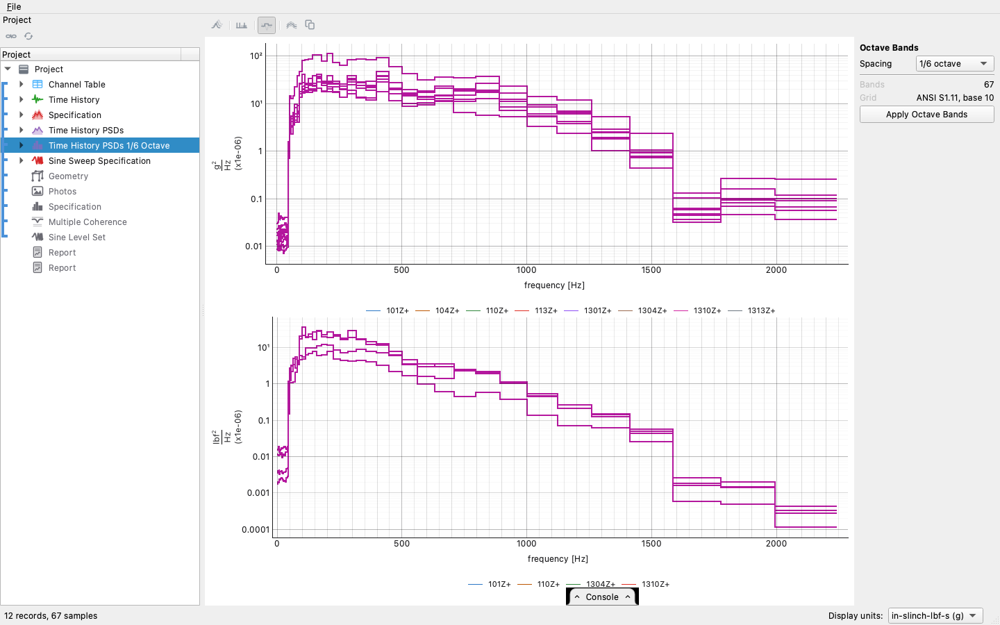

# The random and sine workflow

A random and sine test runs both at once on the same shakers: a
broadband random held to its power spectral density at the control
channels, with one or more sine tones sweeping under it at a
controlled level. One recording has to meet two requirements, and the
two are judged separately, the random by [its own
workflow](random-workflow.md) and the sweep by [its
own](sine-workflow.md), because a PSD says nothing about a tone's level
and a tracked level says nothing about the band around it. This
project type holds both halves and makes two reports, a random report
and a sine report, each read the way its own test is.

The walkthrough uses the demonstration plate's mixed run: the random
specification of the random workflow, with a quiet sweep from 100 to
800 Hz about 10 dB under it. The sweep is quiet enough that only the
extraction can read it. The recording does not ship with the
repository. It is made by the controller (`generate_plate_sine.py` in
the generators repository) and saved as `stressdata/plate/mixed.nc4`.

| Step | In the app | In a script |
|---|---|---|
| Import the run | drag the `.nc4` onto the window | `project.import_file(path)` |
| Both specifications | arrive with the run, the random's and the sweep's | (read from the file's two environments) |
| The random half | PSDs, octave bands and coherence, as in the random workflow | `visualdynamics.mixed_run(path)` does this and the next |
| The sine half | Extract Sine Levels on the time history's bar | `project.extract_sine(project.time_history)` |
| Geometry and photos | drag them in, link them | `project.add(...)`, `project.link(...)` |
| Reports | Generate Report on the bar, with the project row selected: a random report and a sine report | `project.generate_report('random')`, `project.generate_report('sine')` |
| Or all of it at once | Automatic on the tree bar, once the project has its type | `project.work_up()` |
| Save | File → Save Project As… | `project.save('mixed.vdyn')` |

## What the file says, and what the project becomes

A controller file names its environments, and a file with a random
environment and a sine environment that both drove the article is
imported as a *Random and Sine* project. Both specifications arrive:
the random's as the PSD target with its warning and abort limits, and
the sweep's as its tones with their schedules and bands. The tree
shows the slots of both halves (the random's PSD, octave bands and
coherence, then the sine specification and the sine levels), gray
until each is filled, and the two reports last.


A sweep that controlled a virtual point through a response
transformation, while the random controlled the raw channels, imports
the same way. The sine specification is over the transformation's
rows, numbered from 1, and the rows' time histories are recorded
beside the raw channels; the levels are read from those rows.

## The random half

Follow the [random vibration workflow](random-workflow.md): average
the PSDs of the control channels over the frames the controller used,
band them and the specification onto proportional bands, and compute
the multiple coherence. From a script, `random_vibration_run` does all
of it, and `mixed_run` does it and the sine half together.





One point does not come up in a random-only run: the control spectra
are of the whole recording, sweep included. A tone adds its power
across the band it swept, so a control channel reading high there may
be the tone rather than the random. The random report says so where
that comparison is drawn.


## The sine half

Follow the [sine sweep workflow](sine-workflow.md): Extract Sine Levels
reads each tone along its own trajectory out of the same recording,
with the random treated as the noise it is extracted from, and the
levels are judged against each tone's required amplitude and its
bands. In this run the sweep sits 10 dB under the random, where a
spectrum shows nothing of it and a tracking filter's reading includes
the random's power, so the extraction is the only reading of the tone
level.


## The reports

Generate Report with the project row selected writes two reports for
the run, a random report and a sine report, the same two a random-only
run and a sweep-only run would get. Each can go to whoever owns its
specification, and each reads the stretch of the run it needs.
Versions through 0.1.0a35 wrote one combined report for this type.


The random report says what a reader of a random-only report would
not need to know. Its summary says a sweep ran under the random and is
judged in its own report. A section after the compliance charts says
the control spectra include the sweep, so a channel reading high
across the band the sweep passed through (and its RMS error and band
outside abort with it) may be the tone. Its kurtosis section says a
channel under three is the sweep, not clipping, since a pure tone's
kurtosis is 1.5. The level beside its verdict is labeled **Random test
level**. The sine report's summary says the random is judged in its
own report.


```python
import visualdynamics

project = visualdynamics.mixed_run('mixed.nc4')      # both halves worked up
random_report = project.generate_report('random')
sine_report = project.generate_report('sine')
project.export_report(random_report, 'mixed_random.html')
project.export_report(sine_report, 'mixed_sine.html')
project.save('mixed.vdyn')
```

Both reports can also come from one call. `run_report` reads the run's
type and writes `<name>_random.html` and `<name>_sine.html`. Given
`last`, the random report reads only that many seconds from the end of
the run, while the sine report always reads the whole run, since a
sweep cut short loses tones. A folder given as the path must already
exist.

```python
visualdynamics.run_report('mixed.nc4', 'reports/', last=120.0)
visualdynamics.run_report()                         # ask for the runs
```

`mixed_run` refuses a run with no sine specification and says why,
rather than working up half of what was asked for;
`random_vibration_run` is the call for that run.

## Where judgment lives

- Two requirements, one recording. Neither half's reading is corrected
  for the other: the random's PSDs include the tone's power, and the
  tone's level is read with the random as noise. The random report
  states this, because a reader deciding whether an exceedance is real
  needs to know what else was in the band.
- A tone's spike on the random's PSD is not its level. Its height moves
  with the line spacing and the window; the tone itself is read off the
  same PSD by summing the lines it leaks into, less the floor, as the
  **Tones** reading on the bar does
  ([Reading a tone off an ASD](../tone-readout.md)). The sine half's
  tracked levels remain the levels the report judges.

    

- The two halves can also be read as one test. The sine view's **Mixed
  Mode** readout tracks the tones and takes them out, judges the floor
  on what is left with the lines around each tone left out, and gives
  the data sheet: the floor, each tone in g peak and the total, each by
  its own rule ([A mixed-mode test as one
  specification](../mixed-mode.md)). The two reports remain the record
  of each half.

- Each report has its own verdict. The random report's is read off the
  octave-band comparison, and the level beside it is labeled **Random
  test level**: the random half's comparison is scaled to its
  specification when the run was at reduced level. The sine report
  judges each tone in its own figures and bars, always as measured.
- Which specification the run was for is still the engineer's call.
  Both are in the project, each judged in its own report; the project
  type only says that both belong there.
