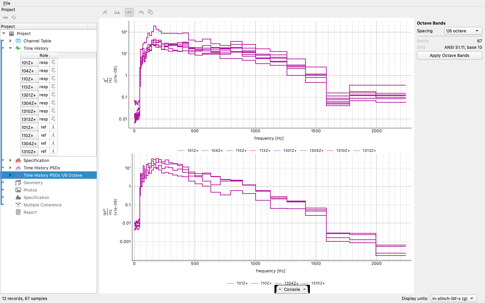

# The random vibration workflow

This workflow takes a controller run in and writes a compliance report
out. A random test is judged against a band: the specification gives
the control PSD the run had to hold, the warning and abort lines say
how far it was allowed to stray, and the report shows where the run
sat inside that band, channel by channel.

The walkthrough uses the demonstration plate's random test: eight
control channels and four shakers, controlled to a shaped
specification in a real Rattlesnake run, with a screenshot at every
step. The run ships with the repository (`testdata/plate/random.nc4`),
so every step can be followed exactly.

| Step | In the app | In a script |
|---|---|---|
| Import the run | drag the controller's `.nc4` onto the window | `project = visualdynamics.random_vibration_run(path)` |
| Say what it is for | nothing to do: the run sets the type | `project.project_type == 'Random Vibration'` |
| Control PSDs | Compute PSDs in the Averaging view | `project.compute_psds('Time History')` |
| The octave-band view | Octave Bands on the PSD's bar | `project.compute_octave('Time History PSDs')` |
| Multiple coherence | Multiple Coherence in the Averaging view | `project.compute_multiple_coherence('Time History')` |
| Compare against the spec | select PSD and specification together | `plot_comparison(psds, spec)` |
| Several control channels | Composite on the bar | `multi_point(spec, psds)` from `visualdynamics.core.multi_point`, `plot_multi_point(psds, spec)` |
| Geometry and photos | drag them in, link them | `project.add(...)`, `project.link(...)` |
| Report | Generate Report on the bar, with the project row selected | `project.generate_report('random')` |
| Or all of it at once | Automatic on the tree bar, once the project has its type | `project.work_up()` |
| Export | Export → HTML… | `project.export_report(name, path)` |
| Save | File → Save Project As… | `project.save('random.vdyn')` |

## In the app, step by step

### 1. Import the run

Drag the controller's save onto the project tree.


 A Rattlesnake random run
carries the control time histories, the specification with its warning
and abort lines, and the channel table in one file. It also records
which environment drove it, so the project type is set to *Random
Vibration* on import. The gray slots in the tree show what a finished
report still needs.

A run that would take a quarter or more of the machine's memory is not
imported whole without asking. The import window shows one channel's
envelope over the whole run, and you choose the stretch to import on
it: drag the window's edges, type a start and a stop, or type a value
in **Last** to import that many seconds from the end of the run. Last
is the usual choice for a long run, because the end is the stretch at
full level. A run shorter than the Last value is imported whole. The
channel list beside the preview lets you leave channels out.

**Save Truncated Copy…** in the same window writes the chosen stretch
as a new `.nc4` with every channel and every setting of the original,
its clock starting at zero. **File → Truncate Rattlesnake File…** opens
the same window for any run, whatever its size, with no import.

A run exported as text (a `.csv` or a recorder's `.txt`) imports the
same way, through a dialog that shows the delimiter, the time column,
the sample rate and each channel's name and unit as found, on a preview
of the channels; [Importing a time history from delimited
text](../text-import.md) says what is found and what is refused. Such
a file carries no specification and no channel table, so those slots
stay gray until they are added.


Before any spectrum is read, look at each channel in the time domain:
**Statistics** on the bar reads the selected channel's mean, rms,
skewness, kurtosis and crest factor, counts its samples on the rail
when its range is typed in, sets its tails beside the Gaussian's and
draws its kurtosis frame by frame, with anything outside its band in
bold. A clipped channel's spectrum sits a fraction of a decibel from a
clean one, and [its time statistics](../time-statistics.md) are where
it shows.


### 2. Compute the control PSDs

Select the time history, open the **Averaging** view and press
**Compute PSDs**. The averaging uses the frame length, overlap and
window the controller used, read from the file. The start and the
number of frames are worked out from the record: where the run is at
level, and how many frames that stretch holds. This is the same answer
the view's **Detect** button gives, and the view marks those frames on
the trace before you press the button. Beside the number of averages,
the view shows what they are worth: the degrees of freedom, nominal and
discounted for overlap, and the 90 percent confidence band they give
(see [What an average is worth](../averaging-confidence.md)).


Before a PSD is read, **RMS Check** on its bar checks it against the
run: the rms from the area under it beside the rms of the time history
over the same frames, and the gap in dB. A spectrum computed here
agrees within a few hundredths of a decibel; one imported from the
controller can be checked against the run the same way, and a scaling
error shows as a gap the check names (see [Checking a spectrum against
its record](../rms-check.md)).

### 3. Band onto sixth octaves

A random report always includes the octave-band PSD and the
specification on the same bands. Select the PSD and choose **Octave
Bands** on its bar. The view previews the banded steps over the
narrowband as you set the **Spacing** (a sixth of an octave by
default), and **Apply Octave Bands** makes the banded PSD. Banding
conserves the area under the curve, so the octave PSD is still a PSD;
it is drawn as bars because its `bandwidth` is set. Do the same with
the specification selected: its requirement and its warning and abort
limits are banded together, and the report's octave section compares
the banded measurement with that banded requirement rather than with
the breakpoint curve.


The report opens with a pass/fail box under its title, **PASS** in
green or **FAIL** in red, read off the octave-band comparison. Beside
it are the two numbers it was decided on: the share of control
channels with more than a tenth of their band outside the abort limits
(the test fails at a fifth of the channels), and the share more than
3 dB off in RMS (the test fails at a tenth). To its left, a box of the
same size gives the test level the comparison was judged at, 0 dB for
a run at full level or −6 dB for one captured 6 dB below the
specification, and says whether that level was detected from the data
or set in the Scaling field. The octave-band figures in the report use
a log frequency axis and the narrowband figures a linear one.

The report draws the measured time histories flat, one figure per
quantity, up to two dozen channels to a page of the figure, each page
an envelope of its channels on one shared time axis with the averaged
frames marked. Every number in the report keeps seven significant
digits, enough to draw a figure to a part in ten million. Together
these keep the report of a large run (144 channels at 16 kHz, for
example) to a few megabytes.



### 4. Multiple coherence

Press **Multiple Coherence** in the same Averaging view, so it is
computed over the same frames as the PSDs. It shows how much of each
response the drives account for. This is the figure that later tells
an exceedance of the article from an exceedance caused by the
instrumentation: a channel the drives explain (coherence near one)
exceeded because the article did.


### 5. Compare against the specification

Select the control PSDs and the specification together. One channel
is drawn at a time, and the drop-down on the bar reaches the rest. The
tolerance zones are shaded, and every line outside the abort band is
striped red (above) or blue (below). The table below the plot lists
every channel at once, and the plot shows the ones you pick in it. How
a line or a band is judged in or out (an area against an area over
each cell, whatever form the two objects take) is described on
[its own page](../compliance.md).

Two things on the bar above the plot are worth checking. The
**Scaling** field is the comparison's dB offset. For a run captured
below the 0 dB requirement it is detected from the data, to the
nearest 3 dB, since runs are commanded in 3 dB steps. This run was at
full level, so it reads 0. The status bar also lists the records that
had no specification to compare against: the drive force PSDs share
DOF names with the control channels, and the comparison leaves them
out rather than judging newtons against an acceleration band.


Before a full-level run with limit channels, the low-level run answers
where they will notch. Compute its FRFs against the control channel,
select them with the specification (and the limit profiles, if they are
held apart from it) and press **Notch Prediction**: each limit channel
is predicted at full level against its profile, and each notch the
controller would cut is given with its band, its depth and whether it
leaves the tolerance ([Predicting the notch before the
test](../limit-prediction.md)).

A run controlled at several points has a second result beside the
comparison of each channel: the composite the controller held, against
the composite band. **Composite** on the bar draws it heavy over the
control channels, with each channel against its own band and the lines
where a channel is outside its band while the composite is inside
counted. The composite can be in tolerance at every line with a
channel far out, which is why the report carries both; see [Judging a
multi-point control run](../multi-point.md).

### 6. Geometry, photos, report

Drag the article's geometry in and declare its units, drop the setup
photographs beside it, and link them into the group. Then select the
project row and press **Generate Report** on the bar to build the
random report. It holds the front matter (geometry, the DOF figures,
photographs and channel table), the measured time histories, the
control spectra against the specification, and the two compliance bar
charts (RMS error and lines outside abort), then the same comparison
and charts again on octave bands, and finally the multiple coherence
and kurtosis figures that say whether an exceedance is the article or
the measurement.


The comparison is one figure per control channel, with no drop-down
anywhere in the report. Each figure opens on the specification's own
frequency band, and the measurement beyond it is a zoom away; a banded
specification is drawn on its own bands, steps against steps. With
more than four control channels the figures are laid out as a grid
instead, a row per node and a column per direction. When the linked
geometry can place the channels, the columns are the global axes and a
channel's cell notes how far off that axis it sits; when it cannot, the
columns are the DOF's own direction letters. Each cell is the figure
that channel would have had on its own.

The row under each figure, beside **Reset Axes**, carries two numbers:
**% Lines Out**, the share of the channel's band outside its abort
limits, and **RMS Error**, how far its level sits from the
specification's in decibels. Each number is in a box, gray inside the
tolerance, red over it and blue under it (only the RMS error can be
under). They are the numbers the two bar charts draw, against the same
tolerances (a tenth of the band and ±3 dB) and in the same colors, so a
failing channel is seen on its own figure.

The channel table keeps every row on one line, however long its
comments. A section whose objects the project does not hold (the
specification sections of a run imported without one, for example) is
left out of the report. **Export → HTML…** on the report's bar writes
one self-contained file.


## The same run, headless

The **Console** tab along the bottom of the window shows the session
as Python while you work: every act as the line that replays it.
Expand it, copy the lines you want, and they run as they are.

The whole workflow is one call when the defaults are right:

```python
import visualdynamics

visualdynamics.random_vibration_report('random.nc4', 'report.html')
```

It is still one call when the report needs the rest of what the tree
asks for. The geometry comes in as it is; the report draws it as a
shape and never states a coordinate or a scale, so no length unit is
needed. The photographs come from a folder (or a list of files, in the
order they should appear), and `last` imports only that many seconds
from the end of a long run, with a shorter run taken whole:

```python
visualdynamics.random_vibration_report(
    'random.nc4', 'report.html',
    geometry='article.stp',
    photos='setup_photos/',
    last=100.0)
```

Called with no run at all, it opens a file dialog, takes as many runs
as you choose, and writes one report for each. A run chosen that way
is also asked about its geometry, where Cancel means none:

```python
visualdynamics.random_vibration_report()                # ask for both
visualdynamics.random_vibration_report(path='reports/')  # ask, write here
```

A list of runs is a batch too, for a script that already has them.
**File → Reports from Runs…** runs the same kind of batch from the
window through `visualdynamics.run_report`, which picks each run's
report from its type ([the sine guide](sine-workflow.md#one-call) has
the details).

A run named in the call with no geometry keyword gets no geometry, and
no dialog opens. Pass `visualdynamics.ASK` for either one to force the
question, so a script that names its run can still be asked for the
geometry.

`path` may be the file to write or a folder to write into, where each
report takes its run's own name with an `.html` extension. A name
ending in a separator (`reports/`) is a folder, and it is made if it
does not exist yet. A name that does not exist and does not end in a
separator is taken as a file, since a folder nobody has made cannot be
told from a file nobody has written. Without a path, the report is
written beside the run. Several runs need a folder, or no path at all.

When the project should be kept, write the same call out step by
step. This is condensed from
[`examples/random_workflow.py`](https://github.com/visualdynamics/visualdynamics/blob/main/examples/random_workflow.py),
which the test suite runs; the step numbers match the walkthrough.

```python
import visualdynamics
from visualdynamics.plot import plot_bars, plot_coherence_map, plot_comparison

# 1-4. import and work up: PSDs over the run's own frames, the
# sixth-octave banding, the coherence, all in one verb
project = visualdynamics.random_vibration_run('random.nc4')
assert project.project_type == 'Random Vibration'

history = project.time_history
spec, octave_spec = project.specifications   # the requirement, and it on bands
psds, octave = project.psds                  # the specifications are not among them

# 5. the comparison, drawn headless: bands against bands
plot_comparison(psds, spec, path='control.png', show=False)
plot_comparison(octave, octave_spec, path='control_octave.png', show=False)
plot_bars(psds, spec, 'error', path='error.png', show=False)
plot_bars(psds, spec, 'lines', path='lines.png', show=False)
plot_coherence_map(project.coherence, path='coherence.png', show=False)

# 6. geometry, photos, report
project.add('Geometry', visualdynamics.import_file('geometry.npz'))
project.geometry.define_units('m')
project.link(*project.names)
project.set_basis(*project.names)
project.generate_report('random')
project.export_report(project.report, 'random_report.html')
project.save('random.vdyn')
```

## Where judgment lives

- Whether an exceedance is the article or the instrumentation.
  The multiple coherence map answers it. A channel whose response the
  drives explain exceeded because the article did; a channel low on
  coherence may have a mounting or cable problem. The report places
  the coherence map after the compliance charts for this reason.
- Whether the comparison scale is right. A run captured below the
  requirement is compared scaled up to the 0 dB specification, which
  is standard practice, and the scale is detected only when the data
  supports it. A controller scales every channel together, so the
  level is read once for the whole test, in sixth-octave bands. Every
  band of every compared channel is assigned its nearest 3 dB step,
  and the most common step is taken as the level only when all of the
  following hold: three quarters of the bands are within 1.5 dB of it
  and their median is within 0.75 dB of it, the total power agrees
  with it within 3 dB, and it is a level a controller would command
  (between 6 dB over and 24 dB under the specification). A run that
  failed is shown as measured, not scaled to look like a reduced-level
  run. That includes a controller that went unstable and ran hot, one
  that held its resonant peaks and little else, and one under-driven
  between steps. A run whose specification bounds monitor channels as
  well as controls is also shown as measured, because the monitors
  spread the bands. One case no rule can catch: a full-level test held
  3 dB low everywhere looks exactly like a run commanded at −3 dB and
  is read as one, which is why the report's test-level box says what
  was detected. Type a number in the Scaling field to hold the scale
  (0 holds it unscaled), and clear the field to detect it again. The
  data itself is never changed. A script that calls `compare_all`
  without a scale gets a `ScaleWarning` when a scale was detected.
- Whether a recorder's file was taken to a lower rate before it was
  compared. A file decimated with no filter carries everything above
  its new Nyquist frequency folded into its band, and a narrow peak
  there can be an alias. **Resample** on a time history's bar shows
  what a resampling does to the record's spectrum, and
  `history.resample(rate)` filters before it decimates; see
  [taking a record to a lower sample rate](../resample.md).
- What the run was allowed to do. The warning and abort lines come
  from the specification. Whether a brush against the warning line
  matters is for the test engineer to write in the conclusions.
- A run controlled to a matrix, several drives and a specification
  with cross terms, is judged as one: select the specification with the
  run's CPSD and choose **Matrix** for the levels on the diagonal and
  each cross term's coherence and phase against their tolerances
  ([Judging a cross-spectral matrix](../matrix-comparison.md)). The
  channel comparison above judges the autospectra alone.
