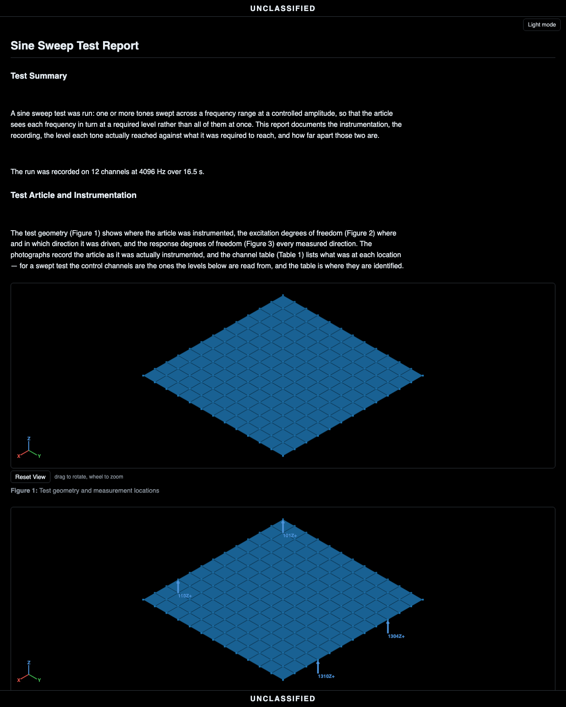

# The sine sweep workflow

A sine test drives the article at one tone, or several at once, and
moves each tone along its own schedule. The specification is a
trajectory to hold rather than a band to fill: a frequency at each
time and a level at each frequency, with warning and abort tolerances
around it. The question the workflow answers is whether each tone held
its level everywhere along its path.

The walkthrough uses the demonstration plate's sweep: four
simultaneous tones on four shakers into eight control channels, each
tone on its own schedule (one sweeping up, one sweeping down through
it, a near-dwell, and a log sweep), 16.5 seconds at 4096 Hz. The
recording does not ship with the repository. It is made by the
controller (`generate_plate_sine.py` in the generators repository) and
saved as `stressdata/plate/sine.nc4`.

| Step | In the app | In a script |
|---|---|---|
| Import the run | drag the `.nc4` onto the window | `project.import_file(path)` |
| The specification | arrives with the run, nothing to declare | (read from the file's environment) |
| See the sweep itself | the time history's Wavelet view | `plot_scalogram(...)` from `visualdynamics.plot` |
| Set the smoothing | the Sine Levels view: Automatic, or a number of cycles | `history.sine_extraction = SineExtraction(cycles=40)`, from `visualdynamics.core.sine` |
| Extract the levels | Extract Sine Levels on the bar, or in the view | `project.extract_sine(project.time_history)` |
| Judge them | select levels and specification together | `plot_comparison(levels, spec)` from `visualdynamics.plot` |
| Geometry and photos | drag them in, link them | `project.add(...)`, `project.link(...)` |
| Report | Generate Report on the bar, with the project row selected | `project.generate_report('sine')` |
| Or all of it at once | Automatic on the tree bar, once the project has its type | `project.work_up()` |
| Save | File → Save Project As… | `project.save('sine.vdyn')` |

## In the app, step by step

### 1. Import the run and its specification

Drag the controller's recording onto the window. Unlike a shock or a
transient recording, a sine run records what it is: the file's
environment carries the tones' schedules, so the project is typed
*Sine Sweep* on import and the specification is already in the tree.
It holds each tone's frequency trajectory, the target level along it,
and the warning and abort bands around that.


Selecting the specification opens it on the 3-D stage (frequency
across, time receding, amplitude up, one surface per tone). Turn off
the **3D** toggle for the flat per-channel view shown here. The rows
under the specification in the tree are its control DOFs, one per
row, and picking rows limits either view to those DOFs. The tone is
chosen in a drop-down on the bar. The stage draws every chosen DOF at
once, each in its own color; the flat view draws one at a time, chosen
in the pair box on the bar.


### 2. See the sweep itself

Before extracting anything, look at the record in time and frequency.
Select the time history and choose **Wavelet** on its bar: it draws
frequency against time with amplitude as color. In a multi-tone sweep
the four tones are four ridges, each following its own path and
crossing where the schedules cross. A PSD would average all of that
together.


The ribbed look along each ridge is in the record, not added by the
transform. Tones that pass within a wavelet's bandwidth of each other
beat at their difference frequency, and that modulation is in the
measured signal: band-pass the record with no wavelet involved and the
same ripple is there.

### 3. Extract the levels

With the time history selected, press **Extract Sine Levels** on the
bar. It reads each tone's achieved level out of the recording with a
Vold-Kalman filter. Each tone's frequency trajectory is rebuilt from
the specification, and the amplitudes of all the tones are solved for
at once, each held to a slowly varying curve over a set number of
cycles. A swept tone never stays at one frequency long enough for an
average, which is why a PSD cannot give this reading. Because the
tones are solved together, two tones that run close for a stretch are
separated by their different frequency histories. A tracking filter
applied to one tone at a time picks up the other tone's level as part
of its own.


The one setting is how many cycles each reading averages over, and it
is stored on the time history. Choose **Sine Levels** on the time
history's bar (offered when the project holds a sweep specification)
to see it. The view lists the setting and what follows from it: the
cycles used, the smoothing window in seconds at the start and end of
the sweep, the scatter a reading is predicted to have, and how much of
the sweep is under the noise floor. A preview plot shows readings
sampled along each tone at that setting, so you can judge the
smoothing before making anything.

With **Smoothing** at **Automatic**, the number of cycles is raised,
starting at ten, until a reading is predicted to scatter less than the
**Scatter under** value (1 dB by default), and the view reports what
it chose. A clean sweep needs few cycles, and a sweep under a random
environment can need forty or more. **Set** uses the number typed in
**Cycles**. **Follow the clock**, on by default, fits the sweep's
clock to the recording and solves again when the recorded sweep
drifted from the commanded one, so a long run does not read low
toward its end.


The button in the view is the same Extract Sine Levels. A reading
where the tone was under the noise is reported at the noise floor and
drawn as a hollow ring, so the plot shows how much was not seen
instead of leaving a gap. The deviation score leaves those readings
out.

One object comes out, grouped the way the specification groups its
tones, with a clock for each tone. Select the levels and the
specification together to draw each measured path over its target and
zones, with the clocks aligned: on the stage by default, or flat with
the 3D toggle off. The signed deviation bars judge the whole run tone
by tone.


### 4. Geometry, photos, report

Drag the article's geometry in, declare its units, add the setup
photographs, and link the group. Then select the project row and press
**Generate Report**. The sine report holds the front matter (geometry,
DOF figures, photographs, channel table), the measured time histories,
the extracted levels drawn over the requirement and its bands, a bar
chart of the signed RMS deviation for each tone at each control
channel (shaded past ±3 dB), and the kurtosis by channel. The level
figures are never overlaid across tones, because each tone sweeps its
own frequencies on its own clock: there is one figure per tone and
control channel, or, when tones times control channels number more
than four, one grid figure per tone with a cell for each channel.




## The same run, headless

The **Console** tab along the bottom of the window shows the session
as Python while you work: every act as the line that replays it.
Expand it, copy the lines you want, and they run as they are.

```python
import visualdynamics

project = visualdynamics.Project('Plate Sine Sweep')

# 1. the run carries its own specification; the project arrives typed
project.import_file('sine.nc4')
assert project.project_type == 'Sine Sweep'

# 2. geometry, photos, links
geometry = visualdynamics.import_file('geometry.npz')
geometry.define_units('m')
project.add('Geometry', geometry)
project.link(*project.names)
project.set_basis(*project.names)

# 3. the levels each tone actually held, solved jointly (Vold-Kalman)
project.extract_sine(project.time_history)

# 4. report and save
project.generate_report('sine')
project.export_report(project.report, 'sine_report.html')
project.save('sine.vdyn')
```

## Where judgment lives

- A mixed run is a project type of its own. A random environment over
  a quiet sweep (a qualification test with a tracked tone) is imported
  as a *Random and Sine* project: both specifications import, the tree
  shows both halves' slots, and Generate Report writes two reports, a
  random report judging the random against its PSD and a sine report
  judging each tone against its level. The random report's control
  spectra are of the whole recording, sweep included, and it says so
  where a reader could otherwise take the tone for an exceedance. See
  [the random and sine workflow](mixed-workflow.md).
- The extraction is per tone, not per band. Each tone is read along
  its own trajectory, and all of them together, so two tones crossing,
  or running close for several seconds, do not add error to each
  other's levels the way a fixed filter bank or a tracking filter
  would. The extractor cannot separate two tones that share a
  trajectory: a tone's harmonic that lands on another tone's path is
  read as that tone.
- A controller's level is read differently. Its tracking filter and
  detector have settings, and a harmonic, noise or a fast change in
  level moves its reading in ways that do not move the extraction.
  [How a tracking filter reads a sweep](../sine-tracking.md) reads a
  record the way a controller does, setting by setting.
- A resonance's Q can be read off a level, by its half-power width
  (`level.half_power(frequency)`), but only off a slow sweep. A mode
  swept faster than it can build reads late, low and wide, and its Q
  low; [Reading Q from a peak's half-power width](../half-power.md)
  says how slow is slow enough.
- A sweep's rate decides what it can show of a resonance. A mode needs
  about Q cycles to build, and a log sweep at R oct/min gives it about
  86.6 / (Q R) seconds in its half-power band; above about
  87 fn / Q² oct/min the peak reads low, late and wide, and a Q read
  off the level reads low. The Sweep Rate reading of the specification
  checks every tone against the modes typed into it, and flags a Q read
  off a level swept too fast for it;
  [Checking a sweep rate](../sweep-rate.md) explains the arithmetic.

    

- A dwell is one point over frequency. A tone held at one frequency (a
  sweep across a hair of a hertz, as `SineTone.dwell` writes it and a
  controller's file carries it) is read against time instead:
  the build-up, the steady level and the ring-down after the stop,
  each in cycles ([Reading a dwell against time](../dwell.md)). The
  sine view's Dwell readout shows them beside the record.
- Where the levels wobble, look at the wavelet first. A ripple in an
  extracted level can come from the article (a resonance swept
  through), from the test (two tones beating in one band), or from the
  extraction. The scalogram shows which: a resonance is a bright patch
  at a fixed frequency, beating is ribbing where ridges pass close, and
  neither is the extractor's doing.
- A survey before the test and one after it are compared mode by
  mode, not by eye. Two tracked levels (or two FRFs) selected together
  offer the **Signature** reading: each mode's frequency and amplitude
  shift against the plan's limits, a window drawn on each mode. See
  [comparing signatures before and after a
  test](../signature-comparison.md).
- Ramp time is part of the trajectory. A tone leaves its start
  frequency at `start_time + ramp_time`, and the extracted clock is
  aligned to the tone's onset, so a lead-in before the sweep starts is
  not a level error and the comparison does not read it as one.

## One call

The whole thing is one call when the defaults are right, with the same
batch and folder rules as `random_vibration_report`: a run left out is
asked for, several may be chosen, and a folder path (one that already
exists) writes each report under its run's own name.

```python
import visualdynamics

visualdynamics.sine_report('sweep.nc4', 'report.html')
visualdynamics.sine_report('sweep.nc4', 'reports/', geometry='article.stp',
                           photos='setup_photos/', marking='TEST SERIES 4')
visualdynamics.sine_report()                     # ask for the runs and the geometry
project = visualdynamics.sine_run('sweep.nc4')   # the project, to keep working with
```

`marking` is the banner across the top and bottom of every page,
`'UNCLASSIFIED'` when it is not given. A run that is random alone is
`random_vibration_report`. A run that is random and sine together gets
both reports from `run_report`, below.

`visualdynamics.run_report` is the same call without the type: it
reads each run's own type and writes that report, so a batch may mix
sweeps, random runs and system identifications. A random-and-sine run
gets two reports, `<name>_random.html` and `<name>_sine.html`, and the
sine report reads the whole run even when `last` cuts the random one.
A streamed save with the shape of a system ID (two streams, a quiet one
then a loud one) is taken as one.

```python
visualdynamics.run_report('run.nc4', 'reports/', geometry='article.stp', marking='TEST SERIES 4')
visualdynamics.run_report(['run_1.nc4', 'run_2.nc4', 'run_3.nc4'], 'reports/',
                          geometry='article.stp', marking='TEST SERIES 4')
```

A list of runs is a batch. Every run's type is read before the first
report is written, so a batch that holds a run with no one-call
report, a modal survey for example, is refused before anything is
written.

The same batch runs from the window. **File → Reports from Runs…**
asks for the runs, then lists them in a table. Each run's **Report**
starts at the report its file declares and can be changed to another,
or to **Leave out**. A run with no one-call report starts at Leave out,
with the reason beside its name. Each run's **Last** is how many
seconds from the end of the run to read, *whole run* by default. The
**Last, for every random report** box below the table sets it for every
random report at once, including the random half of a random-and-sine
run, and leaves sine and system ID runs whole. A script does the same
with `kinds={run: 'random', ...}` and `last={run: 120.0, ...}`. The
same dialog takes the geometry, where the reports go (beside each run,
or in one folder) and the marking. The reports are written in the
window's display units, with the progress bar and Cancel at the bottom
of the window. A cancel takes effect when the run in progress
finishes, and the reports already written are kept. The open project
is not changed.
