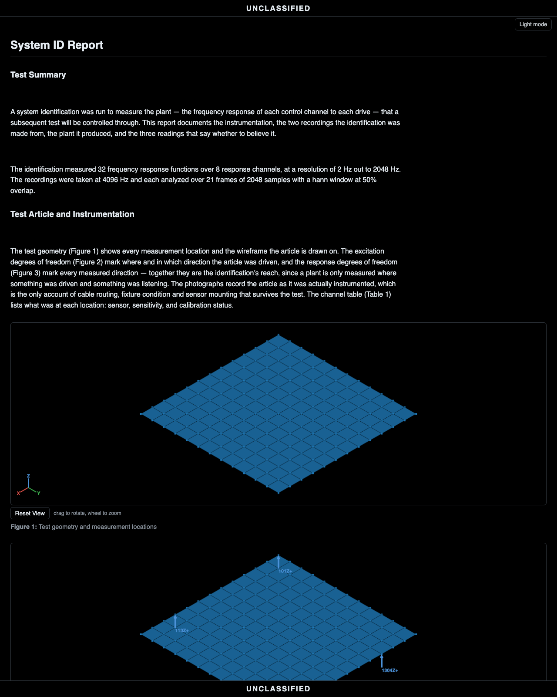

# The system identification workflow

Before a MIMO vibration test can be controlled, the controller needs a
model of the plant: it drives every shaker with known excitation,
measures every response, and estimates the FRF matrix between them. A
system ID run is that measurement, and three results decide whether
it is accurate enough to control from: the FRFs themselves, the
multiple coherence (how much of each response the drives account for)
and the signal-to-noise (how far the excitation stood above the
ambient).

The walkthrough uses the demonstration plate's system ID: four
shakers driving eight response channels, an ambient recording first
and the driven one after, streamed by the controller to one `.nc4`
file (`sysid_stream.nc4`).

| Step | In the app | In a script |
|---|---|---|
| Import the stream | drag the `.nc4` onto the window; answer Yes to the question | `project.import_file(path)` |
| Say what it is | (the question did) or right-click the project row → Set Project Type → System ID | `project.project_type = 'System ID'` |
| The FRFs | **Compute FRFs...** in the Averaging view, estimator H1 | `project.compute_frfs(name, 'H1')` |
| Check the FRFs: coherence | **Multiple Coherence** in the same view | `project.compute_multiple_coherence(name)` |
| Check the FRFs: signal-to-noise | PSDs of both recordings; select the pair; **Signal to noise (dB)** or **RMS signal to noise** | `project.compute_psds(...)` twice, then `plot.plot_ratio(...)` or `plot.plot_snr(...)` |
| Geometry and photos | drag them in, link them | `project.add(...)`, `project.link(...)` |
| Report | *Generate Report* on the bar, the project row selected | `project.generate_report('sysid')` |
| Or all of it at once | **Automatic** on the bar above the tree, once the project has its type | `project.work_up()` |
| Save | File → Save Project As... | `project.save('sysid.vdyn')` |

## In the app, step by step

### 1. Import the stream, and answer the question

A streamed system ID save holds two time streams, a quiet one and then
a loud one, and the file itself does not say whether that is a system
ID or an ordinary run of the same environment that stopped and
restarted. So the app asks.

1. Drag the `.nc4` onto the window.
2. The app asks *Treat this project as a System ID test?* Answer Yes.
   The project type becomes System ID, and the two streams are named
   by level: Noise Time History for the ambient and Excitation Time
   History for the driven.

The question is not asked when the project is already typed System
ID (the streams are named directly), or when the second stream is not
at least 10 dB louder than the first, as in a run that stopped and
restarted at one level.


### 2. The FRFs, by H1

1. Select Excitation Time History and turn on **Averaging** on the
   plot bar.
2. Press **Compute FRFs...** and choose H1 as the estimator.

H1 assumes the noise is on the response, which is the case here: the
plant is measured while being driven with a known excitation. The
controller uses the same estimator for this measurement. The drives
are the channels whose role is `ref` in the history's Role column (the
channels the file says were driven), and a channel marked `mon` is in
no FRF ([the tree](../project-tree.md)).


### 3. Check the FRFs: multiple coherence

1. In the same Averaging view, press **Multiple Coherence**.

The multiple coherence shows, line by line, how much of each response
all the drives together account for. A dip means the response holds
something the drives did not put there (a rattle, ambient noise, a
nonlinearity) at those frequencies, and an FRF line under a coherence
dip is a line the control law will invert without a good estimate
behind it. With one drive, the FRF view's **Transmissibility** toggle
puts the random error the coherence and the averages give around H1,
and the ASD ratio beside it, which parts from H1 wherever the
coherence is low ([The two transmissibilities](../transmissibility.md)).
With several drives, the FRF view's **Conditioning** toggle draws the
singular values of the FRF matrix and its condition number, and hatches
the lines where the drives reach the responses in nearly the same
proportions, the lines a controller's inverse will be mostly noise at
([Checking the matrices of a multi-input
test](../mimo-matrix-checks.md)).


### 4. Check the FRFs: signal-to-noise

1. Compute PSDs of both recordings with the same frame settings, since
   the two densities can only be compared on the same frequency lines.
   In Noise Time History's Averaging view, set the same frame length,
   overlap and window as the excitation's, then press **Compute PSDs**
   on each history. (*Automatic* and the script below copy the
   excitation's averaging to the ambient for you.)
2. Select the two PSDs together.
3. Choose one of the two readings on the plot bar. The signal-to-noise
   is a reading of the pair and is not stored as a third object.


**Signal to noise (dB)** draws one curve per channel, line by line.
Where the excitation stood 30 dB over the ambient, the FRF there is a
good measurement. A line with no signal above the ambient is not
drawn.

**RMS signal to noise** draws one bar per channel, the same ratio
taken over the whole band. Channels under the threshold (10 dB to
start) are colored, and the threshold can be dragged. A channel with
no signal above its noise has no bar and is labeled as at the noise
floor. A channel whose ambient recorded nothing is left off, and the
status line says how many were.

How both are computed, and the definition they follow, is in
[How the signal-to-noise is computed](#how-the-signal-to-noise-is-computed).


### 5. Geometry, photos, report

1. Drag the article's geometry in and declare its units.
2. Add the setup photographs.
3. Select the group and press **Link**.
4. Select the project row and press *Generate Report*.


The system ID report includes both recordings with their frames, the
excitation and ambient densities overlaid per channel, the FRF
magnitudes, the multiple coherence as a map (frequency across, channel
down), the signal-to-noise per channel, the RMS signal-to-noise bars,
and the kurtosis of each recording. Every figure in it is 2-D, as in
the random and sine reports, which keeps the file small. A figure of
more than 24 curves continues into further figures rather than
leaving channels out.



## The same run, headless

You do not have to write the script by hand. The *Console* tab along
the bottom of the window records the session as you work, each action
as the line that replays it. Expand it, copy the part you want, and it
runs as it stands.

The whole workup is one call when the defaults are right:

```python
import visualdynamics

visualdynamics.system_id_report('sysid.nc4', 'sysid.html')
```

It asks for anything it is not given, the same way
[the random vibration report](random-workflow.md) does. Called with no
run, it opens a file dialog, takes as many recordings as are chosen
and writes one report for each; when the run is chosen that way, it
asks once for a geometry to use for the whole batch, and Cancel means
none. `path` may be the file to write or a folder, where each report
is written under its run's own name.

```python
visualdynamics.system_id_report()                  # ask for both
visualdynamics.system_id_report(path='reports/')   # ask, write here
```

`visualdynamics.system_id_run` does the same workup and returns the
project instead of a report, for when the project should be kept: to
save it as `.vdyn`, or to compare the plant with something else.

The same steps written out:

```python
import numpy as np

import visualdynamics

project = visualdynamics.Project('Plate System ID')

# 1. import; a script is never asked, so the type is declared and the
# two recordings are named for what they are, quiet first
project.import_file('sysid_stream.nc4')
project.project_type = 'System ID'
histories = sorted(
    (name for name in project.names
     if type(project[name]).__name__ == 'TimeHistory'),
    key=lambda name: float(np.asarray(project[name].ordinate).std()))
project.rename(histories[0], 'Noise Time History')
project.rename(histories[1], 'Excitation Time History')

# 2. geometry, photos, links
geometry = visualdynamics.import_file('geometry.npz')
geometry.define_units('m')
project.add('Geometry', geometry)
project.link(*project.names)
project.set_basis(*project.names)

# 3. the plant, and the two checks on it
project.compute_frfs('Excitation Time History', 'H1')
project.compute_multiple_coherence('Excitation Time History')
project.compute_psds('Excitation Time History')
project['Noise Time History'].averaging = \
    project['Excitation Time History'].averaging
project.compute_psds('Noise Time History')

# 4. report and save
project.generate_report('sysid')
project.export_report(project.report, 'sysid_report.html')
project.save('sysid.vdyn')
```

## How the signal-to-noise is computed

Signal-to-noise ratio is the power of the signal over the power of the
noise. The definition is the standard one, used for digitizers in
IEEE Std 1241 and for random data by Bendat and Piersol
(*Random Data: Analysis and Measurement Procedures*, 4th ed., Wiley,
2010).

A system identification does not record the signal alone. The ambient
recording is the noise \(N\): the room, the amplifiers, the cabling and
the sensors, with the drives at zero. The driven recording is the
signal plus that same noise. When the noise is uncorrelated with the
signal, their powers add, so the signal's power is the driven power
less the ambient power. At each frequency line \(f\), with \(G_d\) the
driven autospectral density and \(G_n\) the ambient one,

\[
\mathrm{SNR}(f) = \frac{G_d(f) - G_n(f)}{G_n(f)},
\qquad
\mathrm{SNR_{dB}}(f) = 10 \log_{10} \mathrm{SNR}(f).
\]

The RMS signal-to-noise of a channel uses the mean-square value of
each recording over the band the two densities share, which is the
area under the density, \(P = \int G(f)\,df\), integrated the way the
density is drawn:

\[
\mathrm{SNR_{RMS,dB}} = 10 \log_{10} \frac{P_d - P_n}{P_n}
= 20 \log_{10} \frac{\text{signal RMS}}{\text{noise RMS}}.
\]

The plain quotient \(G_d / G_n\) is \(\mathrm{SNR} + 1\). The two
agree when the margin is large and differ near the noise floor:

| Driven over ambient | Signal to noise |
|---|---|
| 3 dB | 0 dB |
| 6 dB | 4.8 dB |
| 10 dB | 9.5 dB |
| 20 dB | 19.96 dB |

The quotient reads high on exactly the channels the reading is meant
to find, so both the curve and the bars use the subtracted form.
Visual Dynamics 0.1.0a33 and earlier drew the plain quotient, so
signal-to-noise figures made with those versions read high near the
noise floor.

Where the driven power does not exceed the ambient, there is no signal
to state. That happens on a channel the drives never reached, and on
single lines where estimation scatter puts the driven density under the
ambient one. The curve leaves those lines out, and the bars give the
channel no number, label it as at the noise floor, and count it under
the threshold.

A line or channel whose ambient recorded exactly zero is a different
case. On hardware that is noise below the recording's resolution, and
in a simulation it is an ambient recording that was exactly silent.
There is no noise to divide by, so the curve leaves the line out, and
the bars leave the channel out and say how many channels that was.
Otherwise a simulated drive point's load cell, whose ambient is
silent, would be flagged as the worst channel when it is the cleanest.

The same quantity sets the threshold. With the noise on the response,
the ordinary coherence between drive and response is
\(\gamma^2 = \mathrm{SNR} / (1 + \mathrm{SNR})\) (Bendat and Piersol).
At 10 dB that is 0.91, about where a coherence is usually required to
be, so the bars start their threshold at 10 dB.

The RMS value is a summary. It is dominated by the frequencies where
the power is, and a channel can read 30 dB over the band while sitting
on its noise floor across part of it. The bars rank the channels, and
the curve shows where in the band a channel was weak.

The two recordings also answer a narrower question than the coherence
does. The ambient recording measures the noise of the measurement
chain. The multiple coherence measures everything in the response the
drives do not account for, which also includes rattles, nonlinearity
and inputs that were not measured. That is why the report shows both.

## Where judgment lives

- The question at import is asked because the file cannot answer it.
  Two streams, quiet then loud, is also what a stop-and-restart run
  leaves. The 10 dB check keeps the question from being asked about
  most ordinary runs, but the answer is yours.
- Which save to work from. The controller also writes a spectral
  package: the FRF matrix, the multiple coherence and the driven and
  ambient spectra it computed itself. That package imports directly,
  but it records hardware channel numbers and no units. The stream
  carries the channel table, so everything computed from it has real
  node labels and engineering units and links to the geometry. When
  both exist, work from the stream and keep the package as the
  controller's own cross-check.
- A drive channel's signal-to-noise reads NaN. Its ambient recorded
  silence, so there is no ratio to state, finite or infinite. Those lines are not drawn, and the bars leave the channel
  out and count it in the caption.
- Coherence near one is necessary but not sufficient. It says the
  responses are linearly explained by the drives; it does not say the
  levels were high enough above the ambient, which is what the
  signal-to-noise reading shows. The plant estimate needs both to be
  good.
